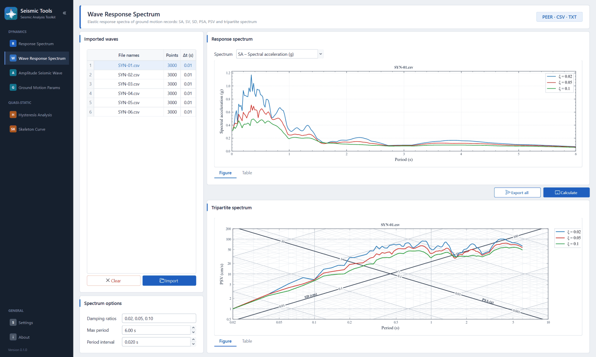

# Seismic Tools

[简体中文](README.md) | **English**

A desktop tool for structural seismic analysis (PySide6 + Matplotlib) that covers dynamic analysis and the processing of quasi-static test data.

## Features

| Group | Features |
| --- | --- |
| Dynamics | **Response Spectrum** — Generate design acceleration response spectra in accordance with GB 50111-2006, JTG/T 2231-01-2020, and GB 50011-2010 (2016 Edition) |
|  | **Wave Response Spectrum** — Seismic wave response spectra (SA, SV, SD, PSA, PSV) and the tripartite spectrum. Supports multiple damping ratios |
|  | **Amplitude Seismic Wave** — Seismic wave amplitude is scaled to the target peak acceleration. The time axis can also be scaled. |
|  | **Ground Motion Params** — 35 ground motion parameters (peak value, intensity, duration, spectral intensity, frequency parameters) |
| Quasi-static | **Hysteresis Analysis** — Hysteresis loop segmentation, secant stiffness, residual displacement, energy dissipation, equivalent viscous damping ratio, hysteresis loop decomposition |
|  | **Skeleton Curve** — Extract skeleton curves and calculate the equivalent yield point (five methods), peak point, ultimate point, and ductility factor. |
|  | **Hysteresis Correction** (experimental) — Corrects the P-Δ effect on the hysteresis curve using three types of vertical loading devices, and compares the characteristic values before and after correction. |
|  | **Test Curve Processing** (experimental) — Detects and removes waiting segments (horizontal segments) from displacement time-history curves. Compares hysteresis curves and time-history curves before and after processing. |
| Pile Foundation | **Pile Data** — Pile cross-sections, soil layers, pile locations, pile cap and load inputs, elevation and plan views, JSON project files, and example calculations |
|  | **Bearing Capacity** — Allowable axial bearing capacity of a single pile (eight methods), verification of pile material properties, verification of pile group efficiency and solid foundations |
|  | **Pile Forces** — The m-method is used to calculate cap displacement, internal forces at the pile head, as well as bending moments, shear forces, displacements, and the distribution of soil resistance along the pile. Influence functions can be obtained from tables or calculated directly. |
|  | **Spring Stiffness** — Six-degree-of-freedom stiffness matrices for pile groups and individual piles. Distributed spring stiffness at the pile shaft, pile side, and pile tip, used for finite element pile foundation simulation |
|  | Export PDF pile foundation reports with a cover page, contents, calculations with LaTeX formulas, and diagrams. Reports follow the interface language. |

All charts can be exported as images by right-clicking (PNG, TIFF, SVG, PDF, etc., with configurable dimensions, resolution, and style), all tables allow you to export data by right-clicking, and pages with multiple curves support one-click batch export.

## Documentation and Interface Languages

The program includes a built-in user manual and supports switching between Chinese and English interfaces.

[中文用户手册](docs/user_guide.md) | [English User Guide](docs/user_guide_en.md)

## Other Versions

C++ version (Qt 6) · [SeismicToolsCpp-Releases](https://github.com/zwk6663666/SeismicToolsCpp-Releases/releases)

## Author

Weike Zhang (zwk6663666@gmail.com)
