# Seismic Tools 用户手册

**简体中文** | [English](README.en.md)

> 适用版本：0.1.0　｜　文档更新：2026-10-28

Seismic Tools 是一款面向结构抗震研究的桌面工具，用于生成规范设计反应谱、计算地震波弹性反应谱与地震动参数、地震波调幅，以及拟静力试验数据的处理（滞回分析、骨架曲线、滞回曲线修正与试验曲线处理），以及桩基础计算（单桩与群桩承载力、桩身内力、有限元模拟用的弹簧刚度）。本手册按程序界面顺序介绍各项功能的操作方法、计算原理与输出格式。

---

## 目录

1. [软件概述](#1-软件概述)
2. [界面总览](#2-界面总览)
3. [数据导入](#3-数据导入)
4. [规范反应谱（Response Spectrum）](#4-规范反应谱response-spectrum)
5. [地震波反应谱（Wave Response Spectrum）](#5-地震波反应谱wave-response-spectrum)
6. [地震波调幅（Amplitude Seismic Wave）](#6-地震波调幅amplitude-seismic-wave)
7. [地震动参数（Ground Motion Params）](#7-地震动参数ground-motion-params)
8. [滞回分析（Hysteresis Analysis）](#8-滞回分析hysteresis-analysis)
9. [骨架曲线（Skeleton Curve）](#9-骨架曲线skeleton-curve)
10. [滞回曲线修正（Hysteresis Correction）](#10-滞回曲线修正hysteresis-correction)
11. [试验曲线处理（Test Curve Processing）](#11-试验曲线处理test-curve-processing)
12. [桩基础（Pile Foundation）](#12-桩基础pile-foundation)
13. [导出功能](#13-导出功能)
14. [全局设置（Settings）](#14-全局设置settings)
15. [常见问题与注意事项](#15-常见问题与注意事项)
16. [参考文献](#16-参考文献)
- [附录 A　单位约定](#附录-a单位约定)
- [附录 B　右键菜单一览](#附录-b右键菜单一览)

---

## 1. 软件概述

### 1.1 功能模块

程序左侧导航栏分为四组。数据依次往后流动的页面合并为一个侧边栏入口，进入后在页面顶部的步骤条中切换各步骤：动力的调幅、反应谱、地震动参数，拟静力的滞回分析、骨架曲线，以及桩基础的四个页面。共十二个功能页面。另有设置、用户手册、关于三个入口：

| 分组 | 侧边栏入口（折叠后简称） | 页面（顶部步骤条） | 主要功能 |
| --- | --- | --- | --- |
| DYNAMICS（动力） | Response Spectrum（Code RS） | Response Spectrum | 按 GB 50111-2006、JTG/T 2231-01-2020、GB 50011-2010（2016 年版）生成设计加速度反应谱 |
| | Ground Motion Analysis（Waves） | ① Amplitude Seismic Wave | 将地震波调幅至目标峰值加速度，可同时缩放时间轴 |
| | | ② Wave Response Spectrum | 计算地震波的 SA、SV、SD、PSA、PSV 反应谱与三联谱，支持多阻尼比 |
| | | ③ Ground Motion Params | 计算 35 项地震动参数（峰值、强度、持时、谱强度、频率参数等） |
| QUASI-STATIC（拟静力） | Hysteresis Analysis（Hysteresis） | ① Hysteresis Analysis | 滞回曲线分圈、特征值（峰值荷载、割线刚度、残余位移、耗能、等效粘滞阻尼比）与滞回环拆解 |
| | | ② Skeleton Curve | 提取骨架曲线，按五种方法计算等效屈服点、峰值点、极限点与延性系数 |
| | Curve Processing（Processing） | Curve Processing（试验功能） | 检测并剔除位移时程曲线中的等待段（水平段），对比处理前后的滞回曲线与时程曲线 |
| | Hysteresis Correction（Correction） | Hysteresis Correction（试验功能） | 按三种竖向加载装置修正 P-Δ 效应对滞回曲线的影响，对比修正前后的特征值 |
| PILE FOUNDATION（桩基础） | Pile Foundation Calculation（Piles） | ① Pile Data | 桩截面、土层、桩位、承台与荷载的输入，立面图与平面图，JSON 工程文件 |
| | | ② Bearing Capacity | 单桩轴向容许承载力（八种方法）、群桩效率与实体基础验算 |
| | | ③ Pile Forces | m 法计算承台位移、桩顶内力与桩身弯矩、剪力、位移分布，影响函数可查表或直接计算 |
| | | ④ Spring Stiffness | 群桩与单桩的六自由度刚度矩阵，桩身、桩侧、桩端分布弹簧刚度 |
| GENERAL（通用） | Settings（Settings） | | 导入/导出目录与导出格式的全局默认值 |
| | User Guide（Guide） | | 在程序内置的阅读器中浏览本手册 |
| | About（About） | | 版本与作者信息 |

带圈数字的页面有先后的数据流向，按数字顺序排列。同一入口下的页面通过页面顶部的步骤条切换，再次点击侧边栏入口会回到上次停留的步骤，详见 [2.5 节](#25-工作流步骤条)。

侧边栏底部的语言按钮可在中文与英文界面之间切换，切换立即生效，已导入的数据与计算结果保持不变。为便于对照，本手册中的界面名称以英文界面为准；图形中的标题、坐标轴与图例随界面语言显示，切换语言后图形立即更新；数据表的表头与行名随界面语言显示（地震动参数等通用缩写除外），导出文件始终使用英文表头。

### 1.2 数据共享关系

- **Wave Response Spectrum** 与 **Ground Motion Params** 共用同一份地震波列表：在任一页面导入或删除，另一页面同步更新。
- **Amplitude Seismic Wave** 调幅得到的地震波，可用页面顶部的 **Send to Wave Response Spectrum** 加入上述共用列表，不必先导出再重新导入。
- **Hysteresis Analysis** 与 **Skeleton Curve** 共用同一份滞回数据列表。
- **Test Curve Processing** 与 **Hysteresis Correction** 每次只导入一个文件，数据各自独立。处理或修正后的数据可用页面顶部的 **Send to** 发送到后续页面：处理后的数据可发送到 Correction（替换其数据）或 Hysteresis Analysis（加入共用列表），修正后的数据可发送到 Hysteresis Analysis。
- **Response Spectrum** 独立管理数据。
- **Pile Data**、**Bearing Capacity**、**Pile Forces** 与 **Spring Stiffness** 共用 Pile Data 页中的同一份桩基模型，修改输入后其他页面的结果会被清除，需要重新计算。

### 1.3 通用特性

- 所有绘图均可**右键导出为图片**（PNG/JPEG/TIFF/SVG/PDF/EPS），可设置尺寸、分辨率、标题、坐标轴标签、字号、刻度方向、图例与网格。
- 所有数据表均可**右键导出数据**（CSV/TXT/自定义后缀），格式选项与全局设置联动。
- 处理多条曲线的页面均提供 **Export all** 按钮，一次批量导出全部曲线的数据表与图形。
- 图形字体统一为 Times New Roman，坐标轴标题与图例字号大于刻度值。
- 界面和图形中的公式与符号（如 $\sigma_{\max}$、$k_h$、$\bar{h}$）均按 LaTeX 排版显示，上下标、希腊字母与分式清晰可读，表头和坐标轴标题中的单位（如 $\mathrm{kN\cdot m/rad}$）也按正体 LaTeX 排版。复制、导出的表头和提示文字使用对应的纯文字，如 σmax。

---

## 2. 界面总览

### 2.1 主窗口布局

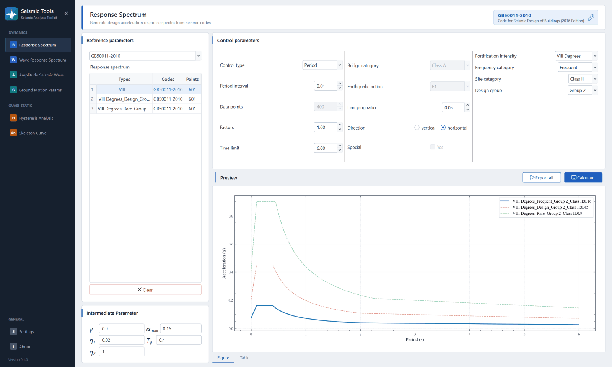

主窗口由以下几部分组成：

1. **侧边栏**（左侧深色区域）：程序 Logo、折叠按钮、功能导航、设置、用户手册与关于入口、语言按钮、版本号。
2. **顶部栏**（顶部白色卡片）：左侧是页面名称或步骤条（见 [2.5 节](#25-工作流步骤条)），把鼠标停在步骤上可看到页面说明；试验功能页在当前步骤后标注“（试验功能）”；右侧是本页的按钮。在规范反应谱页面中，右侧的信息卡显示当前规范的编号与名称，点击可打开规范参数窗口。
3. **左侧信息栏**（固定宽度）：已导入的数据列表、计算参数、特征值汇总等。各页面左侧信息栏宽度一致。
4. **右侧结果区**：图形与表格。多数结果组下方有 **Figure / Table** 两个标签页，分别显示图形与对应数据。

### 2.2 侧边栏折叠

侧边栏右上角的双箭头按钮（«）用于折叠侧边栏。程序启动时默认展开。

- **折叠后**侧边栏收窄为图标栏，各功能以“图标 + 简称”显示（简称见 [1.1 节](#11-功能模块)），分组标题变为分隔线，鼠标悬停在按钮上可查看完整名称。
- 再次点击双箭头按钮（»）恢复展开状态。
- 折叠后右侧结果区可获得更多空间，适合在较小的屏幕上使用。

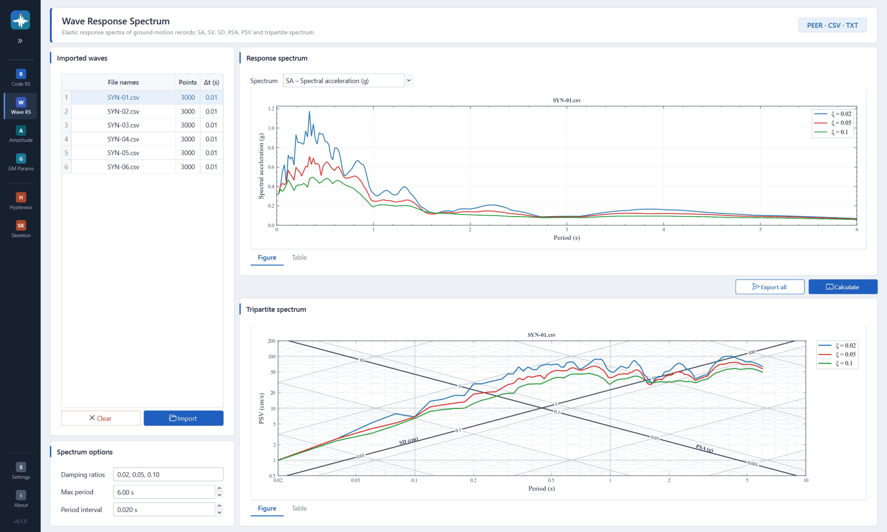

### 2.3 按钮配色约定

同一类作用的按钮使用同一种样式，便于识别：

| 样式 | 作用 | 示例 |
| --- | --- | --- |
| 蓝色实心 | 计算、执行、导入 | Calculate、Import、Decompose loops、Extract skeleton、Calculate yield、Confirm |
| 蓝色描边 | 页面级导出 | Export all、Export selected |
| 灰色描边 | 局部工具 | Export loops（滞回环拆解区） |
| 红色描边 | 清除数据 | Clear |

### 2.4 通用操作

- **选择数据**：在左侧列表中单击某一行，右侧图形与表格切换为该数据的结果。
- **删除数据**：在列表中选中一行或多行，右键选择删除命令。
- **清空数据**：点击列表下方的 **Clear**。
- **悬停提示**：参数输入框、表头、按钮等大多带有悬停提示，说明参数含义或取值依据。
- **导出图形/表格**：在图形或表格上单击右键，详见 [第 13 章](#13-导出功能)。

### 2.5 工作流步骤条

动力的调幅、反应谱与地震动参数，拟静力的滞回分析与骨架曲线，以及桩基础的四个页面，数据是依次往后流动的；曲线处理与滞回曲线修正是独立的预处理页面，各有侧边栏入口，处理后的数据通过页面顶部的 **Send to** 发送到后续页面。这些页面的最上方都有一条步骤条（兼作页面标题栏），按先后顺序列出本组页面。侧边栏中这几组页面各合并为一个入口，不再逐页列出；点击入口进入该组，再次点击会回到上次停留的步骤，第一次进入时停在第一步：


- 当前页面高亮显示，点击其他步骤直接跳转，不必再回到侧边栏。
- 点击步骤或右侧的 **Next** 前往下一步时，程序会自动完成该页的计算（如承载力、桩身内力、弹簧刚度，地震波反应谱、滞回分析、骨架曲线等）。数据不全时（如尚未导入）不会计算，也不会提示。
- 右侧的 **Next** 按钮前往下一步。桩基础各页和滞回分析页共用同一份数据，只需切换页面。
- 本页的结果需要交给后续页面时，按钮显示为 **Send to ...**。点击后先把数据复制过去，再自动打开目标页面。存在多个去向时（曲线处理页）合并为一个 **Send to** 菜单。
- 没有可发送的数据（如尚未导入地震波）时给出提示，不会跳转。
- 最后一步没有后续按钮。
- 桩基础四个页面的顶部栏右侧都有 **Export calculation report...** 按钮，可随时导出计算书（见 [12.8 节](#128-计算书导出)）。

---

## 3. 数据导入

### 3.1 地震波文件

适用页面：Wave Response Spectrum、Ground Motion Params、Amplitude Seismic Wave。

点击左侧列表下方的 **Import**，打开导入设置窗口，设置完成后点击 **OK** 选择文件（可多选）。

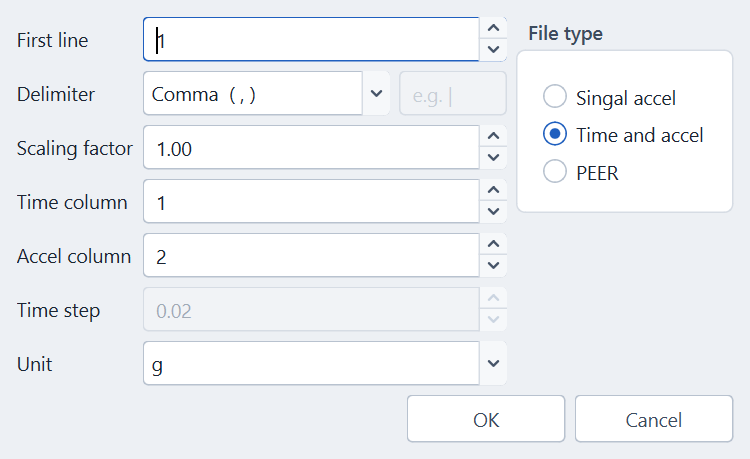

#### 文件类型（File type）

| 类型 | 说明 | 使用的设置项 |
| --- | --- | --- |
| **Time and accel** | 多列文本，含时间列与加速度列（默认） | First line、Delimiter、Time column、Accel column、Scaling factor、Unit |
| **Singal accel** | 单列加速度（若有多列，取第一列），时间由时间步长生成 | First line、Delimiter、Time step、Scaling factor、Unit |
| **PEER** | PEER NGA 数据库 `.AT2` 格式 | Scaling factor、Unit |

#### 设置项

| 设置项 | 说明 | 默认值 |
| --- | --- | --- |
| First line | 数据起始行号（从 1 开始），之前的行（文件头）被跳过 | 1 |
| Delimiter | 列分隔符：Comma（,）、Tab（制表符）、Whitespace（任意数量的连续空格或制表符，适用于空格对齐的文本）、Semicolon（;）、Custom（在右侧输入框中输入单个字符） | Comma |
| Scaling factor | 加速度缩放系数，读入后乘以该系数 | 1.00 |
| Time column | 时间所在列（从 1 开始） | 1 |
| Accel column | 加速度所在列（从 1 开始） | 2 |
| Time step | 单列加速度的时间步长 $\Delta t$（s） | 0.02 |
| Unit | 文件中加速度的单位：g、m/s^2、cm/s^2、mm/s^2 | g |

读入后的加速度统一换算为以 g 为单位（$g = 9.80665\ \mathrm{m/s^2}$）：

$$
a = k \cdot c_{\mathrm{unit}} \cdot a_{\mathrm{file}}
$$

式中 $a_{\mathrm{file}}$ 为文件中的数值，$k$ 为 Scaling factor，$c_{\mathrm{unit}}$ 为单位换算系数：g 取 $1$，m/s^2 取 $1/9.80665$，cm/s^2 取 $1/980.665$，mm/s^2 取 $1/9806.65$。

#### 文件示例

Time and accel（逗号分隔，单位 g）：

```text
0.00,0.000000
0.01,0.000388
0.02,-0.000209
...
```

Singal accel（每行一个值，Time step 设为记录的时间间隔）：

```text
0.000000
0.000388
-0.000209
...
```

PEER（`.AT2`）：程序在文件前 4 行中查找 `NPTS` 与 `DT` 关键字，读取该行之后的全部数值作为加速度序列：

```text
PEER NGA STRONG MOTION DATABASE RECORD
...
ACCELERATION TIME SERIES IN UNITS OF G
NPTS=  5000, DT=   .0100 SEC
  .1234E-03  .2345E-03 ...
```

#### 说明

- 记录的时间间隔应均匀。若不均匀，Wave Response Spectrum 与 Ground Motion Params 会按时间间隔的中位数重新等间隔线性插值后再计算。
- 列表中 **Points** 为数据点数，**Δt (s)** 为时间间隔（中位数）。
- 文件名相同的记录再次导入时会覆盖原记录。
- 读取失败的文件会在导入结束后统一列出原因，其余文件正常导入。

### 3.2 滞回曲线文件

适用页面：Hysteresis Analysis、Skeleton Curve（两页共用数据），以及 Hysteresis Correction、Test Curve Processing（见本节末尾的说明）。

点击 **Import** 打开 **Load hysteresis file** 窗口，设置完成后确认并选择文件（`.csv`、`.txt` 或任意文本文件，可多选）。

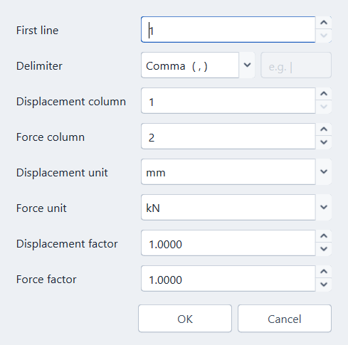

| 设置项 | 说明 | 默认值 |
| --- | --- | --- |
| First line | 数据起始行号；该行之后开头的非数值行（表头）会被自动跳过 | 1 |
| Delimiter | 分隔符：Comma（,）、Tab、Whitespace（任意空白字符）、Semicolon（;）、Custom（自定义） | Comma |
| Displacement column | 位移列（从 1 开始） | 1 |
| Force column | 力列（从 1 开始），不能与位移列相同 | 2 |
| Displacement unit | 文件中位移的单位：mm、cm、m、in | mm |
| Force unit | 文件中力的单位：N、kN、kip | kN |
| Displacement factor / Force factor | 位移、力的缩放系数（如需换向可输入负值） | 1.0 |

数据要求：

- 位移–力数据按**加载顺序**排列，每行一个数据点。
- 数据应从零位移附近开始，正负往复加载。程序以位移过零划分加载半圈（详见 [8.4 节](#84-计算方法)）。

程序内部统一以 mm、kN 存储与计算；页面上可随时切换显示单位（见 [8.2 节](#82-分析参数)），图形、表格与特征值同步换算。导入后，页面的显示单位会自动设为所导入文件的单位。

Hysteresis Correction 与 Test Curve Processing 页面使用同一个导入窗口，但每次只选择一个文件，导入新文件会替换原有文件。滞回曲线修正的竖向力时程曲线文件只有力一列，其导入窗口不显示位移列、位移单位与位移系数。

### 3.3 示例数据

安装程序会把示例数据复制到 `文档\SeismicTools\Import Data\samples`，也就是默认的导入目录下，导入对话框打开后进入 `samples` 文件夹即可导入试用；卸载时这些文件会保留。

| 文件 | 用于 | 说明 |
| --- | --- | --- |
| `hysteresis_sample.csv` | Hysteresis Analysis、Skeleton Curve、Hysteresis Correction（水平力） | 滞回曲线，逗号分隔，首行为表头 `Displacement (mm),Force (kN)`，共 17 201 个数据点；位移控制往复加载，幅值 2、4、6、8、10、14、18、22、26、30、35、40 mm，每级循环 2 次，共 24 圈 |
| `hysteresis_waiting_sample.csv` | Test Curve Processing | 在上述曲线的基础上加入等待段：试验开始前静置，每个循环结束回到零位移时停机等待，各循环另在正向或负向峰值处随机保载；等待时长约 180～800 点且各不相同，力按指数规律松弛；共 36 559 个数据点、42 个等待段 |
| `vertical_force_displacement_sample.csv` | Hysteresis Correction（Source：Force-displacement） | 竖向力–位移曲线，首行为表头 `Displacement (mm),Vertical force (kN)`，共 5 734 个数据点；取自上述滞回曲线的每 3 个点，位移保留一位小数，采样点数与位移精度均与水平力曲线不同，竖向力均值约 500 kN |
| `vertical_force_history_sample.csv` | Hysteresis Correction（Source：Time history） | 竖向力时程曲线，单列，首行为表头 `Vertical force (kN)`，共 4 000 个数据点，均值约 500 kN |
| `earthquake_wave_sample.csv` | 地震波相关页面 | 人工合成地震动，Time and accel 类型（逗号分隔，无表头，单位 g），共 4 000 个数据点，$\Delta t = 0.01$ s，持时 40 s，PGA 0.30 g，频谱较宽（模拟中硬场地） |
| `earthquake_wave_soft_site.AT2` | 地震波相关页面 | 人工合成地震动，PEER 类型（单位 g），共 2 500 个数据点，$\Delta t = 0.02$ s，持时 50 s，PGA 0.18 g，长周期成分丰富（模拟软土场地） |

滞回曲线数据文件含表头时，程序自动跳过开头的非数值行；地震波文件须用 First line 跳过表头，因此两个地震波样例不含表头，按默认设置即可导入。

地震波样例由 Kanai–Tajimi 滤波白噪声乘以强度包络（上升、平稳、衰减）合成，并缩放到给定的峰值加速度，**不是真实记录**，仅用于试用反应谱、地震动参数与调幅等功能。

---

## 4. 规范反应谱（Response Spectrum）

根据抗震设计规范生成设计加速度反应谱，可连续生成多条反应谱进行对比。


### 4.1 支持的规范

| 规范号 | 规范名称 |
| --- | --- |
| GB50111-2006 | 铁路工程抗震设计规范（Code for Seismic Design of Railway Engineering） |
| JTG/T 2231-01-2020 | 公路桥梁抗震设计规范（Specifications for Seismic Design of Highway Bridges） |
| GB50011-2010 | 建筑抗震设计规范（2016 年版）（Code for Seismic Design of Buildings） |

### 4.2 操作步骤

1. 在 **Reference parameters** 区的下拉框中选择规范。顶部栏右侧的信息卡同步显示所选规范的编号与名称。
2. 在 **Control parameters** 区设置规范参数与采样参数（见 4.3 节）。参数改变时，**Intermediate Parameter** 区的中间参数会按规范自动更新。
3. 如需调整中间参数（例如采用场地安评值），可直接修改 Intermediate Parameter 中的数值，计算时以输入框中的数值为准。
4. 点击 **Calculate**，生成的反应谱添加到 **Response spectrum** 列表，并在 **Preview** 区显示。
5. 单击列表中的某条反应谱，Preview 区以实线突出显示该谱，其余谱以虚线显示；**Table** 标签页显示该谱的周期–加速度数据。图例格式为“类型:峰值”。

列表中的 **Types** 列为“设防烈度_特征周期分区_场地类别”；GB 50011 为“设防烈度_地震水准_设计地震分组_场地类别”，竖向反应谱另加后缀 `_Vertical`。**Codes** 为规范号，**Points** 为数据点数。

### 4.3 参数说明

#### 规范参数

| 参数 | 可选值 | 适用规范 |
| --- | --- | --- |
| Fortification intensity（设防烈度） | VI、VII、VII½、VIII、VIII½、IX 度。GB 50011 中 VII½、VIII½ 分别指 7 度（0.15g）、8 度（0.30g） | 全部 |
| Frequency category（地震动水准） | Design（设计/设防）、Frequent（多遇）、Rare（罕遇） | GB 50111、GB 50011 |
| Site category（场地类别） | GB 50111：Class I～IV；JTG、GB 50011：Class I0、I1、II、III、IV | 全部 |
| Characteristic period（特征周期分区） | GB 50111：Region I/II/III；JTG：0.35、0.40、0.45 s | GB 50111、JTG |
| Design group（设计地震分组） | Group 1、Group 2、Group 3（第一、二、三组）。选择 GB 50011 时代替 Characteristic period 一行显示 | GB 50011 |
| Bridge category（桥梁抗震设防类别） | Class A、B、C、D | JTG |
| Earthquake action（地震作用） | E1、E2 | JTG |
| Damping ratio（阻尼比） | 默认 0.05 | JTG、GB 50011 |
| Direction（方向） | horizontal（水平）、vertical（竖向） | JTG、GB 50011 |
| Special（特殊桥梁） | 勾选后 B 类桥梁按规范表中括号内的数值（高速公路和一级公路上的大桥、特大桥）取 Ci | JTG |

选择 GB 50011 时的默认值为：VI 度、多遇地震、II 类场地、第一组、阻尼比 0.05、水平向。

#### 采样参数

| 参数 | 说明 | 默认值 |
| --- | --- | --- |
| Control type | Period：按固定周期间隔采样；Points：按固定点数采样 | Period |
| Period interval | 周期间隔（s），Control type 为 Period 时有效 | 0.01 |
| Data points | 数据点数，Control type 为 Points 时有效 | 400 |
| Factors | 整体放大系数，最终谱值乘以该系数 | 1.00 |
| Time limit | 最大周期（s），周期范围为 0～Time limit | 6.00 |

#### 中间参数（Intermediate Parameter）

中间参数区共 5 个输入框，显示的符号随所选规范切换：

| 输入框位置 | GB 50111 | JTG/T 2231-01 | GB 50011 |
| --- | --- | --- | --- |
| 左列第 1 行 | —（不使用） | $C_i$ 抗震重要性系数 | $\gamma$ 曲线下降段衰减指数 |
| 左列第 2 行 | —（不使用） | $C_d$ 阻尼调整系数 | $\eta_1$ 直线下降段下降斜率调整系数 |
| 左列第 3 行 | —（不使用） | $C_s$ 场地系数 | $\eta_2$ 阻尼调整系数 |
| 右列第 1 行 | $\alpha$ 水平地震基本加速度（g） | $A$ 设计基本地震动加速度峰值（g） | $\alpha_{\max}$ 地震影响系数最大值（竖向时显示为 $\alpha_{v\max}$） |
| 右列第 2 行 | $T_g$ 特征周期（s） | $T_g$ 特征周期（s） | $T_g$ 特征周期（s） |

### 4.4 规范参数窗口

点击顶部栏右侧的规范信息卡，打开规范参数窗口。窗口按规范分为三个标签页，打开时自动定位到当前所选规范；左侧为参数与中间参数，右侧为对应的规范条文、公式与参数表，便于对照取值。GB 50011 标签页右侧为按规范第 5.1.4、5.1.5 条重新绘制的地震影响系数曲线、形状参数公式与参数表。点击 **Confirm** 后，主页面切换到该标签页对应的规范，参数回填并立即生成一条反应谱。

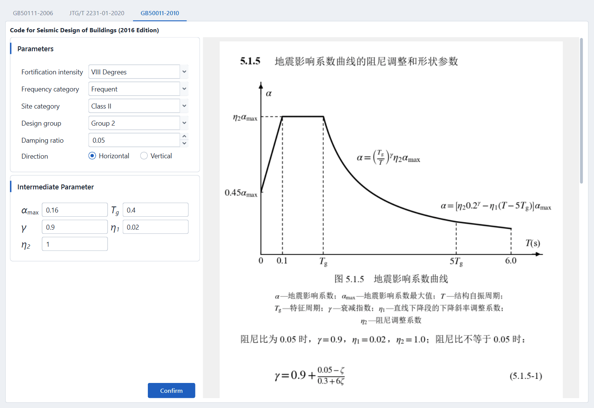

### 4.5 计算公式

#### GB 50111-2006（铁路工程抗震设计规范）

$$
S(T) = \lambda \cdot \alpha \cdot \beta(T)
$$

$$
\beta(T) =
\begin{cases}
1.0 + 12.5T, & 0 \le T < 0.1\ \mathrm{s} \\
2.25, & 0.1\ \mathrm{s} \le T < T_g \\
2.25 \dfrac{T_g}{T}, & T_g \le T < 5T_g \\
0.45, & T \ge 5T_g
\end{cases}
$$

式中 $\lambda$ 为 Factors（整体放大系数），$\alpha$ 为水平地震基本加速度，$T_g$ 为特征周期，$\beta$ 为动力放大系数（规范图 7.2.3）。规范规定 $\beta$ 曲线适用于自振周期小于 2 s、阻尼比 0.05 的结构。

#### JTG/T 2231-01-2020（公路桥梁抗震设计规范）

$$
S_{\max} = 2.5 C_i C_s C_d A
$$

$$
S(T) =
\begin{cases}
\lambda S_{\max} \left( 0.4 + 0.6 \dfrac{T}{T_0} \right), & 0 \le T \le T_0 \\
\lambda S_{\max}, & T_0 < T \le T_g \\
\lambda S_{\max} \dfrac{T_g}{T}, & T > T_g
\end{cases}
\qquad T_0 = 0.1\ \mathrm{s}
$$

$$
C_d = 1 + \frac{0.05 - \xi}{0.08 + 1.65\xi} \ge 0.55
$$

式中 $C_i$ 为抗震重要性系数，$C_s$ 为场地系数，$C_d$ 为阻尼调整系数，$A$ 为设计基本地震动加速度峰值，$\xi$ 为阻尼比。选择 vertical（竖向）时，$C_s$ 与 $T_g$ 分别取竖向场地系数与竖向特征周期。

#### GB 50011-2010（建筑抗震设计规范，2016 年版）

地震影响系数曲线（规范第 5.1.5 条，图 5.1.5）：

$$
\alpha(T) =
\begin{cases}
\lambda \left[ 0.45 + 10 (\eta_2 - 0.45) T \right] \alpha_{\max}, & 0 \le T < 0.1\ \mathrm{s} \\
\lambda \eta_2 \alpha_{\max}, & 0.1\ \mathrm{s} \le T \le T_g \\
\lambda \left( \dfrac{T_g}{T} \right)^{\gamma} \eta_2 \alpha_{\max}, & T_g < T \le 5T_g \\
\lambda \left[ \eta_2 0.2^{\gamma} - \eta_1 (T - 5T_g) \right] \alpha_{\max}, & 5T_g < T \le 6.0\ \mathrm{s}
\end{cases}
$$

形状参数由阻尼比 $\zeta$ 确定（式 5.1.5-1～5.1.5-3），阻尼比为 0.05 时 $\gamma = 0.9$、$\eta_1 = 0.02$、$\eta_2 = 1.0$：

$$
\gamma = 0.9 + \frac{0.05 - \zeta}{0.3 + 6\zeta}, \qquad
\eta_1 = 0.02 + \frac{0.05 - \zeta}{4 + 32\zeta} \ge 0, \qquad
\eta_2 = 1 + \frac{0.05 - \zeta}{0.08 + 1.6\zeta} \ge 0.55
$$

其中：

- $\alpha_{\max}$ 按 4.6 节的表取值。多遇、罕遇地震按规范表 5.1.4-1，设防地震按第 3.10.3 条。
- $T_g$ 按设计地震分组与场地类别取值（规范表 5.1.4-2），计算罕遇地震作用时增加 0.05 s。
- 选择 vertical（竖向）时，竖向地震影响系数取水平地震影响系数的 65%，即 $\alpha_{v\max} = 0.65 \alpha_{\max}$，且特征周期均按设计第一组采用（第 5.3.1、5.3.4 条）。
- 规范规定周期大于 6.0 s 的建筑结构所采用的地震影响系数应专门研究。Time limit 大于 6.0 s 时，程序沿直线下降段外延，且谱值不小于 0。

### 4.6 内置参数表

程序内置以下参数表，并据此自动填写中间参数。

#### GB 50111：水平地震基本加速度 α（g）

| 地震动水准 | VI | VII | VII½ | VIII | VIII½ | IX |
| --- | --- | --- | --- | --- | --- | --- |
| Design（设计） | 0.05 | 0.10 | 0.15 | 0.20 | 0.30 | 0.40 |
| Frequent（多遇） | 0.02 | 0.04 | 0.05 | 0.07 | 0.10 | 0.14 |
| Rare（罕遇） | 0.11 | 0.21 | 0.32 | 0.38 | 0.57 | 0.64 |

#### GB 50111：特征周期 Tg（s）

| 分区 | I 类场地 | II 类 | III 类 | IV 类 |
| --- | --- | --- | --- | --- |
| Region I | 0.25 | 0.35 | 0.45 | 0.65 |
| Region II | 0.30 | 0.40 | 0.55 | 0.75 |
| Region III | 0.35 | 0.45 | 0.65 | 0.90 |

#### JTG/T 2231-01：设计基本地震动加速度峰值 A（g）

| 设防烈度 | VI | VII | VII½ | VIII | VIII½ | IX |
| --- | --- | --- | --- | --- | --- | --- |
| A | 0.05 | 0.10 | 0.15 | 0.20 | 0.30 | 0.40 |

#### JTG/T 2231-01：抗震重要性系数 Ci

| 桥梁类别 | E1 | E2 |
| --- | --- | --- |
| Class A | 1.0 | 1.7 |
| Class B | 0.43 | 1.3 |
| Class B（Special 勾选） | 0.5 | 1.7 |
| Class C | 0.34 | 1.0 |
| Class D | 0.23 | —（无需 E2 计算） |

#### JTG/T 2231-01：特征周期 Tg（s）

| 分区特征周期 | 方向 | I0 | I1 | II | III | IV |
| --- | --- | --- | --- | --- | --- | --- |
| 0.35 | 水平 | 0.20 | 0.25 | 0.35 | 0.45 | 0.65 |
| 0.40 | 水平 | 0.25 | 0.30 | 0.40 | 0.55 | 0.75 |
| 0.45 | 水平 | 0.30 | 0.35 | 0.45 | 0.65 | 0.90 |
| 0.35 | 竖向 | 0.15 | 0.20 | 0.25 | 0.30 | 0.55 |
| 0.40 | 竖向 | 0.20 | 0.25 | 0.30 | 0.35 | 0.60 |
| 0.45 | 竖向 | 0.25 | 0.30 | 0.40 | 0.50 | 0.75 |

#### JTG/T 2231-01：场地系数 Cs

| 场地类别 | 方向 | VI | VII | VII½ | VIII | VIII½ | IX |
| --- | --- | --- | --- | --- | --- | --- | --- |
| I0 | 水平 | 0.72 | 0.74 | 0.75 | 0.76 | 0.85 | 0.90 |
| I1 | 水平 | 0.80 | 0.82 | 0.83 | 0.85 | 0.95 | 1.00 |
| II | 水平 | 1.00 | 1.00 | 1.00 | 1.00 | 1.00 | 1.00 |
| III | 水平 | 1.30 | 1.25 | 1.15 | 1.00 | 1.00 | 1.00 |
| IV | 水平 | 1.25 | 1.20 | 1.10 | 1.00 | 0.95 | 0.90 |
| I0 | 竖向 | 0.6 | 0.6 | 0.6 | 0.6 | 0.6 | 0.6 |
| I1 | 竖向 | 0.6 | 0.6 | 0.6 | 0.6 | 0.7 | 0.7 |
| II | 竖向 | 0.6 | 0.6 | 0.6 | 0.6 | 0.7 | 0.8 |
| III | 竖向 | 0.7 | 0.7 | 0.7 | 0.8 | 0.8 | 0.8 |
| IV | 竖向 | 0.8 | 0.8 | 0.8 | 0.9 | 0.9 | 0.8 |

#### GB 50011：水平地震影响系数最大值 $\alpha_{\max}$

| 地震水准 | VI（6 度） | VII（7 度 0.10g） | VII½（7 度 0.15g） | VIII（8 度 0.20g） | VIII½（8 度 0.30g） | IX（9 度） |
| --- | --- | --- | --- | --- | --- | --- |
| Frequent（多遇） | 0.04 | 0.08 | 0.12 | 0.16 | 0.24 | 0.32 |
| Design（设防） | 0.12 | 0.23 | 0.34 | 0.45 | 0.68 | 0.90 |
| Rare（罕遇） | 0.28 | 0.50 | 0.72 | 0.90 | 1.20 | 1.40 |

多遇、罕遇地震的数值见规范表 5.1.4-1，设防地震的数值见第 3.10.3 条。竖向取上表数值的 65%。

#### GB 50011：特征周期 $T_g$（s）

| 设计地震分组 | I0 | I1 | II | III | IV |
| --- | --- | --- | --- | --- | --- |
| Group 1（第一组） | 0.20 | 0.25 | 0.35 | 0.45 | 0.65 |
| Group 2（第二组） | 0.25 | 0.30 | 0.40 | 0.55 | 0.75 |
| Group 3（第三组） | 0.30 | 0.35 | 0.45 | 0.65 | 0.90 |

计算罕遇地震作用时，上表数值增加 0.05 s；竖向一律按第一组取值。

若某组合在表中没有对应值（例如 D 类桥梁的 E2 地震作用），程序会提示 “Failed to find … value, please enter it manually”，并在输入框中显示 `--`，需手动输入后再计算。

### 4.7 列表操作与导出

| 操作 | 方法 |
| --- | --- |
| 删除反应谱 | 在列表中选中后右键 → Delete selected response spectrum |
| 导出选中反应谱数据 | 右键 → Export selected response spectrum（见 [13.4 节](#134-导出选中的波形反应谱数据)） |
| 清空全部反应谱 | 点击 **Clear** |
| 批量导出 | 点击 **Export all**：可选 Response spectrum data（周期、加速度）与 Response spectrum figure |
| 导出当前图形 / 表格 | 在 Preview 区图形或表格上右键 |

---

## 5. 地震波反应谱（Wave Response Spectrum）

计算地震波记录的线弹性单自由度体系反应谱，同时给出多个阻尼比下的五种谱及三联谱。

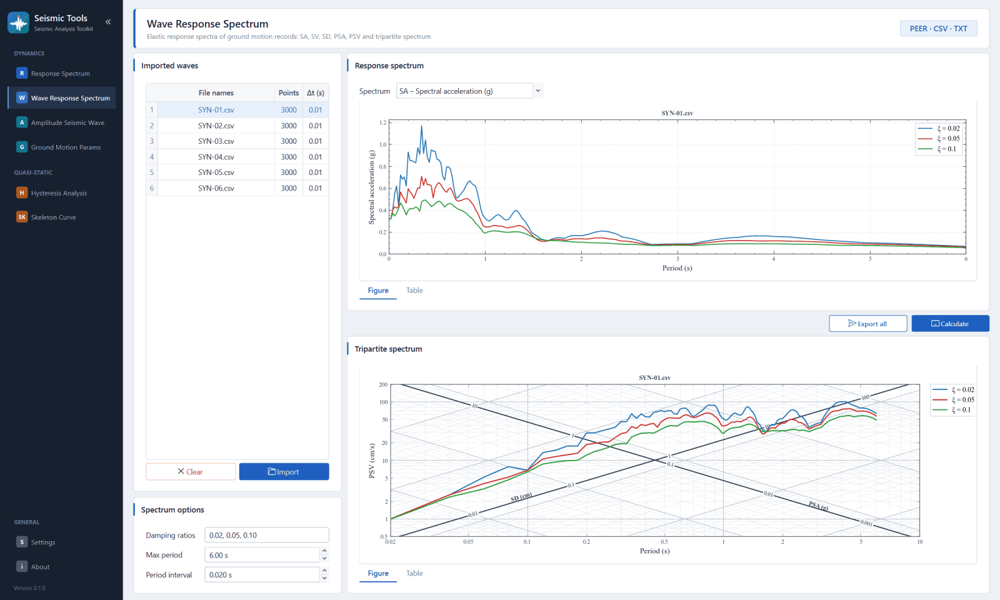

### 5.1 操作步骤

1. 点击 **Import** 导入地震波（见 [3.1 节](#31-地震波文件)），记录显示在 **Imported waves** 列表中。
2. 在 **Spectrum options** 中设置阻尼比与周期范围。
3. 点击 **Calculate**，程序计算列表中**全部**记录的反应谱（记录较多时显示进度条，可取消）。
4. 单击列表中的记录，查看该记录的结果：
   - **Response spectrum** 区：通过 **Spectrum** 下拉框切换谱类型；Figure 显示各阻尼比曲线，Table 显示周期与各阻尼比的谱值。
   - **Tripartite spectrum** 区：Figure 为三联谱，Table 为全部谱类型、全部阻尼比的完整数据。

### 5.2 参数说明

| 参数 | 说明 | 默认值 |
| --- | --- | --- |
| Damping ratios | 阻尼比列表，可用逗号、空格或分号分隔，每个值须在 [0, 1) 内；重复值自动去除并按从小到大排序 | 0.02, 0.05, 0.10 |
| Max period | 最大周期（s），范围 0.1～20 | 6.00 s |
| Period interval | 周期间隔（s），范围 0.001～1 | 0.020 s |

周期序列为 $0, \Delta T, 2\Delta T, \ldots, T_{\max}$，其中 $\Delta T$ 为 Period interval，$T_{\max}$ 为 Max period。修改参数后，当前记录如已有结果会自动按新参数重算；其他记录需再次点击 **Calculate**（批量导出时会自动按当前参数计算）。

### 5.3 谱类型

| 代号 | 名称 | 单位 | 定义 |
| --- | --- | --- | --- |
| SA | 绝对加速度谱 Spectral acceleration | g | $\max \lvert \ddot u(t) + \ddot u_g(t) \rvert$ |
| SV | 相对速度谱 Spectral velocity | cm/s | $\max \lvert \dot u(t) \rvert$ |
| SD | 相对位移谱 Spectral displacement | cm | $\max \lvert u(t) \rvert$ |
| PSA | 拟加速度谱 Pseudo-spectral acceleration | g | $\omega^2 \cdot \mathrm{SD}$ |
| PSV | 拟速度谱 Pseudo-spectral velocity | cm/s | $\omega \cdot \mathrm{SD}$ |

其中 $u(t)$ 为单自由度体系相对地面的位移，$\ddot u_g(t)$ 为地面加速度，$\omega = 2\pi/T$。$T = 0$ 时按刚性体系处理：SA = PSA = PGA，其余为 0。

### 5.4 三联谱

三联谱在双对数坐标中以周期 $T$ 为横轴、PSV 为纵轴绘制。由于

$$
\mathrm{PSV} = \frac{2\pi}{T} \mathrm{SD} = \frac{T}{2\pi} g \cdot \mathrm{PSA}
$$

（SD 以 cm、PSA 以 g 计，$g = 980.665\ \mathrm{cm/s^2}$），图中叠加两组斜向刻度线：SD 为常数时 PSV 与 $T$ 成反比，等 SD 线向左上倾斜；PSA 为常数时 PSV 与 $T$ 成正比，等 PSA 线向右上倾斜。

读图方法：

- 横轴、纵轴刻度按 1-2-5 序列标注，网格线分主次两级。
- 两条加粗的斜线分别为 SD 与 PSA 的刻度线，沿线标注各十进位刻度值（如 0.01、0.1、1、10），线旁的 `SD (cm)`、`PSA (g)` 标明刻度含义。
- 某点的 SD 值：沿等 SD 线（与加粗 SD 刻度线垂直方向的细斜线）读到 SD 刻度线上的数值；PSA 同理。
- 图例位于图形右侧外部，不遮挡曲线。

### 5.5 计算方法

单自由度体系在地面运动下的运动方程为

$$
\ddot u + 2\xi\omega \dot u + \omega^2 u = -\ddot u_g(t)
$$

- 采用分段线性激励精确解（Nigam & Jennings, 1969；Chopra《结构动力学》第 5.2 节）逐步递推，各周期与各阻尼比同时计算。该方法对相邻采样点间线性变化的地震动输入给出精确解，不存在数值积分方法的稳定性与周期延长问题，短周期体系同样适用。
- 记录结束后补零延长 Max period 时长，计入自由振动阶段可能出现的最大响应（对长周期体系尤为重要）。

### 5.6 导出

| 方式 | 内容 |
| --- | --- |
| Export all | Spectrum data (all types)：每条记录一个文件，含全部谱类型与阻尼比；Response spectrum (selected type)：当前选择谱类型的图形；Tripartite spectrum：三联谱图形 |
| 右键 Response spectrum 图形/表格 | 当前记录、当前谱类型 |
| 右键 Tripartite spectrum 图形/表格 | 当前记录的三联谱 / 全部谱数据 |

表头示例：`Period (s), SA ξ=0.05 (g), SV ξ=0.05 (cm/s), …`。

---

## 6. 地震波调幅（Amplitude Seismic Wave）

将地震波按比例缩放到一组目标峰值加速度（PGA），并可同时缩放时间轴。

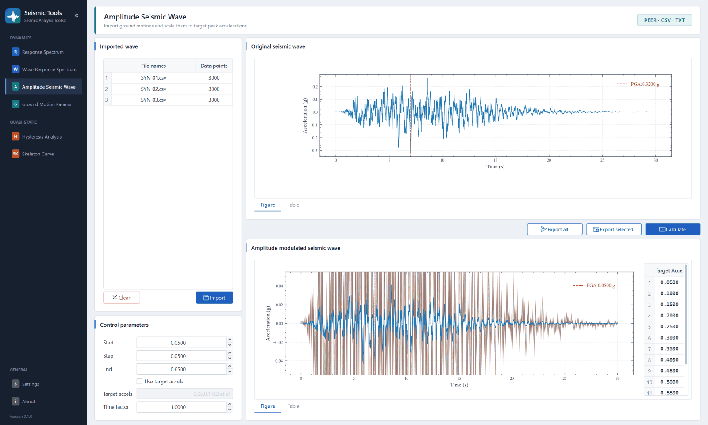

### 6.1 操作步骤

1. 点击 **Import** 导入地震波（见 [3.1 节](#31-地震波文件)），记录显示在 **Imported wave** 列表中（File names、Data points）。
2. 单击列表中的记录，**Original seismic wave** 区显示原始时程（Figure）与数据（Table），图中红色虚线标出 PGA 所在时刻。
3. 在 **Control parameters** 中设置目标加速度与时间系数。
4. 点击 **Calculate**，对全部已导入记录生成调幅波。**Amplitude modulated seismic wave** 区右侧的 **Target Accel** 列表列出各目标加速度，单击可切换显示对应的调幅波。
5. 需要继续计算反应谱或地震动参数时，点击页面顶部的 **Send to Wave Response Spectrum**，全部调幅波（名称形如 `0.1g_原始文件名`）会加入共用地震波列表，并自动打开反应谱页面。

### 6.2 参数说明

| 参数 | 说明 | 默认值 |
| --- | --- | --- |
| Start / Step / End | 目标 PGA 序列：从 Start 到 End、步长 Step（g） | 0.05 / 0.05 / 0.65 |
| Use target accels | 勾选后改用 Target accels 中输入的列表 | 不勾选 |
| Target accels | 目标 PGA 列表（g），以逗号或空格分隔，如 `0.05,0.1 0.2` | — |
| Time factor | 时间缩放系数，时间轴乘以该系数 | 1.0000 |

### 6.3 计算方法

$$
k = \frac{\mathrm{PGA_{target}}}{\max \lvert a(t) \rvert}, \qquad a'(t') = k \cdot a(t), \qquad t' = \lambda_t t
$$

式中 $\mathrm{PGA_{target}}$ 为目标峰值加速度，$k$ 为调幅系数，$\lambda_t$ 为 Time factor。

PGA 为 0 的记录无法调幅，程序会给出提示。

### 6.4 导出

| 方式 | 说明 |
| --- | --- |
| Export all | 批量导出：Amplitude-scaled waves（调幅波数据，默认勾选）、Original waves（原始波数据）、Amplitude-scaled wave figures、Original wave figures。导出前按当前目标加速度重新计算 |
| Export selected | 导出当前原始波对应的全部调幅波（使用波形导出窗口，见 [13.4 节](#134-导出选中的波形反应谱数据)） |
| Imported wave 列表右键 | Delete selected wave / Export selected wave（导出选中的原始波） |
| Target Accel 列表右键 | Delete selected wave / Export selected wave（导出选中的调幅波） |
| 图形、表格右键 | 导出当前显示的图形或数据 |

调幅波文件名为“目标 PGA_原文件名”，如 `0.1_SYN-01.csv`。

---

## 7. 地震动参数（Ground Motion Params）

批量计算地震波记录的 35 项地震动参数，并以图表对比各记录的参数值。

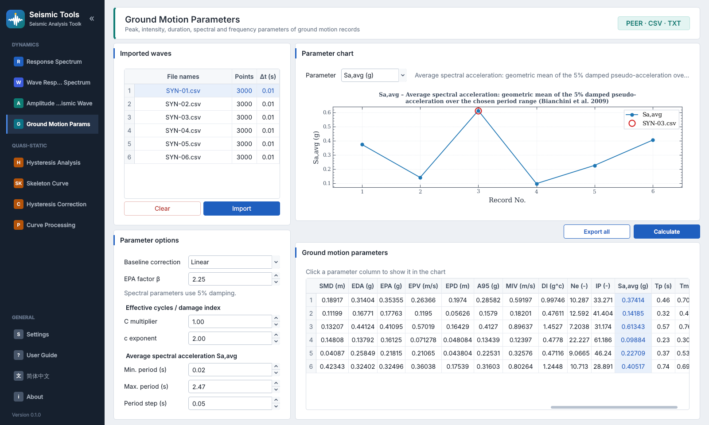

### 7.1 操作步骤

1. 导入地震波（与 Wave Response Spectrum 共用列表，在任一页面导入均可）。
2. 在 **Parameter options** 中设置基线修正方式、EPA 系数 β、Damage Index 的 C 与 c，以及 Sa,avg 的周期范围。
3. 点击 **Calculate**，计算全部记录的参数（显示进度条，可取消）。
4. 下方 **Ground motion parameters** 表格中，每行为一条记录，每列为一项参数。**单击任一参数列（表头或单元格）**，上方 **Parameter chart** 即切换为该参数；也可通过 **Parameter** 下拉框切换。下拉框右侧显示参数说明，表头悬停也会显示说明。
5. 图表横轴为记录编号（Record No.，与表格行号一致），纵轴为参数值。左侧列表中当前选中的记录在图中以红色圆圈标出。

### 7.2 参数选项

| 选项 | 说明 | 默认值 |
| --- | --- | --- |
| Baseline correction | 积分速度、位移前对加速度做最小二乘多项式基线修正：None（不修正）、Mean（0 阶）、Linear（1 阶）、Quadratic（2 阶） | Linear |
| EPA factor β | EPA、EPV、EPD 的谱放大系数，范围 1.0～5.0。2.25 对应 GB 50011 的 $\beta_{\max}$，2.5 对应 ATC-3-06 | 2.25 |
| C multiplier | Damage Index 的线性比例系数 $C$，范围 0.01～1000 | 1.00 |
| c exponent | Damage Index 与有效循环数的指数 $c$，范围 0.1～10 | 2.00 |
| Min. period (s) | Sa,avg 计算的最小周期，范围 0.01 s 起，不超过最大周期 | 0.02 |
| Max. period (s) | Sa,avg 计算的最大周期，不小于最小周期，最大 20 s | 2.47 |
| Period step (s) | Sa,avg 计算的周期步长，范围 0.01～1 s | 0.05 |

#### 输出单位

参数的单位按 **Settings** 窗口 Units 页中选择的加速度、速度、位移单位显示，7.3 节各表的单位列中，[A]、[V]、[D] 分别表示这三种单位（默认是 g、m/s、m），s 表示秒。程序在 g、cm/s、cm 下完成计算，再换算成所选单位，参数表的表头、图表的纵轴和导出文件中的单位同步变化，Damage Index 等带幂次的单位也一并换算。表中的数值取 5 位有效数字。

修改设置后，点击 **Calculate** 才会在本页生效；只改设置、不点击 Calculate 时，页面保持原来的单位。

#### 谱参数的计算条件

谱参数（HSI、ASI、VSI、DSI、EPA、EPV、EPD、Tp、Sa,avg）统一采用 5% 阻尼比。除 Sa,avg 外，周期网格为 0.01～5.00 s、间隔 0.01 s，谱积分采用梯形公式；Sa,avg 的周期点由上面的最小周期、最大周期和步长决定。数值框在输入完成后才生效，修改选项后，已计算的结果自动按新设置重新计算。

### 7.3 参数定义

记号：$a(t)$ 为加速度，$v(t)$、$d(t)$ 为由加速度积分得到的速度与位移，$T_{\mathrm{tot}}$ 为记录总时长，$g = 9.80665\ \mathrm{m/s^2} = 980.665\ \mathrm{cm/s^2}$，积分区间均为整个记录。

#### 峰值类

| 参数 | 名称 | 单位 | 定义 |
| --- | --- | --- | --- |
| PGA | 峰值加速度 | [A] | $\max \lvert a(t) \rvert$ |
| PGV | 峰值速度 | [V] | $\max \lvert v(t) \rvert$ |
| PGD | 峰值位移 | [D] | $\max \lvert d(t) \rvert$ |
| PGV/PGA | 速度加速度比 | s | $\mathrm{PGV} / (g \cdot \mathrm{PGA})$ |
| PGD/PGV | 位移速度比 | s | $\mathrm{PGD} / \mathrm{PGV}$ |
| SMA | 持续最大加速度 | [A] | $a(t)$ 的第 3 大持续峰值（Nuttli, 1979） |
| SMV | 持续最大速度 | [V] | $v(t)$ 的第 3 大持续峰值 |
| SMD | 持续最大位移 | [D] | $d(t)$ 的第 3 大持续峰值 |
| EDA | 有效设计加速度 | [A] | 9 Hz 低通滤波后加速度的最大绝对值（Benjamin & Associates, 1988） |
| EPA | 有效峰值加速度 | [A] | $\dfrac{1}{0.4\beta} \displaystyle\int_{0.1}^{0.5} \mathrm{SA}(T) \mathrm{d}T$ |
| EPV | 有效峰值速度 | [V] | $\dfrac{1}{1.2\beta} \displaystyle\int_{0.8}^{2.0} \mathrm{PSV}(T) \mathrm{d}T$ |
| EPD | 有效峰值位移 | [D] | $\dfrac{1}{2.5\beta} \displaystyle\int_{2.0}^{4.5} \mathrm{SD}(T) \mathrm{d}T$ |
| A95 | A95 加速度 | [A] | 包含 95% Arias 强度的加速度水平（Sarma & Yang, 1987） |

EPA、EPV、EPD 即对应周期区间内谱值的平均值除以 $\beta$（谱值均取 5% 阻尼）。“持续峰值”指绝对值大于其前后各 20 个时间步内所有点绝对值的局部峰值。A95 的求法：将 $\lvert a \rvert$ 由小到大排序后依次累加 $a^2$，累计值达到 $\sum a^2$ 的 95% 时对应的 $\lvert a \rvert$。EDA 的低通滤波在频域完成，增益取 $1 / [1 + (f / 9)^{8}]$，相当于 4 阶 Butterworth 滤波器正反向各滤一次，不产生相位滞后。

#### 均方根与强度类

| 参数 | 名称 | 单位 | 定义 |
| --- | --- | --- | --- |
| Arms | 均方根加速度 | [A] | $\sqrt{\dfrac{1}{T_{\mathrm{tot}}} \displaystyle\int a^2(t) \mathrm{d}t}$ |
| Vrms | 均方根速度 | [V] | $\sqrt{\dfrac{1}{T_{\mathrm{tot}}} \displaystyle\int v^2(t) \mathrm{d}t}$ |
| Drms | 均方根位移 | [D] | $\sqrt{\dfrac{1}{T_{\mathrm{tot}}} \displaystyle\int d^2(t) \mathrm{d}t}$ |
| Ic | 特征强度 | [A]^1.5·s^0.5 | $A_{\mathrm{rms}}^{1.5} \sqrt{T_{\mathrm{tot}}}$（Park et al., 1985） |
| Ia | Arias 强度 | [V] | $\dfrac{\pi}{2g} \displaystyle\int a^2(t) \mathrm{d}t$，$a$ 以 $\mathrm{m/s^2}$ 计（Arias, 1970） |
| SED | 比能量密度 | [V]²·s | $\displaystyle\int v^2(t) \mathrm{d}t$ |
| CAV | 累积绝对速度 | [V] | $\displaystyle\int \lvert a(t) \rvert \mathrm{d}t$ |
| CAV_STD | 标准化累积绝对速度 | [V] | $\displaystyle\sum_{i=1}^{N} H(\mathrm{PGA}_i - 0.025\,g)\int_{i-1}^{i} \lvert a(t) \rvert \mathrm{d}t$（Campbell & Bozorgnia, 2011） |
| CAD | 累积绝对位移 | [D] | $\displaystyle\int \lvert v(t) \rvert \mathrm{d}t$ |
| CAI | 累积绝对冲量 | [D]·s | $\displaystyle\int \lvert d(t) \rvert \mathrm{d}t$ |

CAV_STD 把记录分成 $N$ 个 1 s 的时间窗（最后不足 1 s 的部分也算一个窗），$\mathrm{PGA}_i$ 为第 $i$ 个窗内的峰值加速度，$H$ 为单位阶跃函数。只有峰值加速度超过 0.025 g 的时间窗才计入 $\int \lvert a \rvert \mathrm{d}t$，所以弱震动段不会累积进来。

#### 增量速度、循环与冲击类

| 参数 | 名称 | 单位 | 定义 |
| --- | --- | --- | --- |
| MIV | 最大增量速度 | [V] | 加速度曲线在相邻两个零交叉点之间所围面积 $\left\lvert \int a(t) \mathrm{d}t \right\rvert$ 的最大值（Anderson & Bertero, 1987） |
| DI | 损伤指数 | [A]^c | $C \displaystyle\sum_i n_i A_i^{c}$（Malhotra, 2002） |
| Ne | 有效循环数 | — | $\displaystyle\sum_i n_i \left(\dfrac{A_i}{A_{\max}}\right)^{c}$（Malhotra, 2002） |
| IP | 冲击指数 | — | $\dfrac{\sum \lvert \Delta v \rvert}{\mathrm{PGV}}$（Panella et al., 2017） |

MIV 在零交叉点处按线性插值确定边界，该指标的讨论见 Guaman（2010）。DI 与 Ne 先对加速度时程做雨流计数（ASTM E1049-85 三点法），$A_i$ 为第 $i$ 类循环的幅值（变程的一半，单位 g），$n_i$ 为其次数，整循环计 1，剩余的半循环计 0.5，$A_{\max}$ 为最大的循环幅值，$C$ 和 $c$ 即参数选项中的 C multiplier 与 c exponent，计算步骤的总结见 Hancock & Bommer（2005）。IP 是速度时程的展开长度除以 PGV，展开长度取相邻采样点速度差的绝对值之和，单个脉冲型地震动的 IP 较小，往复次数越多 IP 越大。
#### 持时类

| 参数 | 名称 | 单位 | 定义 |
| --- | --- | --- | --- |
| Td | 显著持时 | s | $t_{95} - t_{5}$（Trifunac & Brady, 1975） |

其中 $t_{5}$、$t_{95}$ 分别为累积 Arias 强度达到总量 5% 与 95% 的时刻。

#### 谱强度类（5% 阻尼）

| 参数 | 名称 | 单位 | 定义 |
| --- | --- | --- | --- |
| HSI | Housner 谱强度 | [D] | $\displaystyle\int_{0.1}^{2.5} \mathrm{PSV}(T) \mathrm{d}T$（Housner, 1952） |
| ASI | 加速度谱强度 | [A]·s | $\displaystyle\int_{0.1}^{0.5} \mathrm{SA}(T) \mathrm{d}T$（Von Thun et al., 1988） |
| VSI | 速度谱强度 | [D] | $\displaystyle\int_{0.1}^{2.5} \mathrm{SV}(T) \mathrm{d}T$（Von Thun et al., 1988） |
| DSI | 位移谱强度 | [D]·s | $\displaystyle\int_{2.0}^{5.0} \mathrm{SD}(T) \mathrm{d}T$（Bradley, 2011） |
| Sa,avg | 平均谱加速度 | [A] | $\left[ \displaystyle\prod_{i=1}^{n} \mathrm{PSA}(T_i) \right]^{1/n}$（Bianchini et al., 2009） |

积分上下限为周期（s）。Sa,avg 取 5% 阻尼的拟加速度谱 PSA，周期点 $T_i = T_{\min} + k \Delta T$（不超过 $T_{\max}$），三个量即参数选项中的最小周期、最大周期和周期步长，取几何平均。默认的 0.02～2.47 s、步长 0.05 s 共 50 个周期点。

#### 频率类

| 参数 | 名称 | 单位 | 定义 |
| --- | --- | --- | --- |
| Tp | 卓越周期 | s | $\arg\max\limits_{T} \mathrm{SA}(T)$，即 5% 阻尼 SA 最大值对应的周期 |
| Tm | 平均周期 | s | $\dfrac{\sum_i C_i^2 / f_i}{\sum_i C_i^2}$，$0.25\ \mathrm{Hz} \le f_i \le 20\ \mathrm{Hz}$（Rathje et al., 1998） |

其中 $C_i$ 为加速度傅里叶幅值谱在频率 $f_i$ 处的幅值。

### 7.4 积分与基线修正

- 速度、位移由加速度按梯形公式积分得到。积分前按 Baseline correction 设置拟合加速度的多项式趋势并扣除，以减小积分漂移对 PGV、PGD 等参数的影响。
- 基线修正**仅用于积分**速度和位移；PGA、Arms、Ia、CAV、CAV_STD、A95、EDA、MIV、DI、Ne 及全部谱参数均基于原始加速度记录计算；IP 基于积分得到的速度。

### 7.5 导出

点击 **Export all**，可选：

| 内容 | 说明 | 默认 |
| --- | --- | --- |
| Parameter table (all records) | 全部记录的参数表，文件名 `ground_motion_parameters` | 勾选 |
| Acceleration, velocity and displacement histories | 每条记录一个文件：时间、修正后加速度、速度、位移（均按所选单位） | 不勾选 |
| Parameter charts (one per parameter) | 35 张参数对比图，文件名 `GM_参数名` | 勾选 |

导出前程序会确保全部记录已按当前设置计算。参数图表与参数表也可右键单独导出。

---

## 8. 滞回分析（Hysteresis Analysis）

处理拟静力（低周往复）试验的力–位移滞回曲线：自动分圈，计算各圈及整体的特征值，并可将每个滞回环拆开查看。

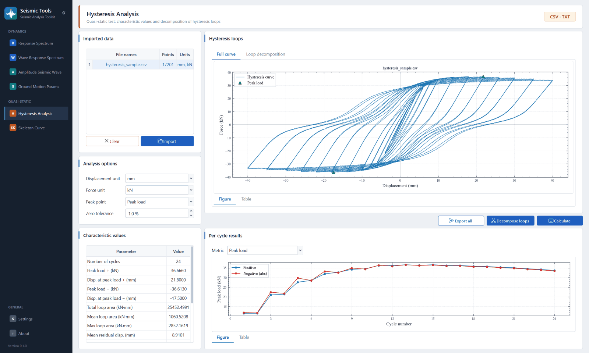

### 8.1 操作步骤

1. 点击 **Import** 导入滞回数据（见 [3.2 节](#32-滞回曲线文件)），数据显示在 **Imported data** 列表中（File names、Points、Units）。
2. 单击列表中的数据，**Hysteresis loops → Full curve** 显示完整滞回曲线（Figure）与原始数据（Table）。
3. 在 **Analysis options** 中设置显示单位、峰值点取法与过零容差。
4. 点击 **Calculate** 计算当前数据：
   - 左侧 **Characteristic values** 显示特征值汇总；
   - 右下 **Per-cycle results** 中通过 **Metric** 下拉框选择指标，Figure 显示该指标随圈数的变化，Table 显示全部每圈结果；
   - 完整滞回曲线上以三角形标出正、负向峰值荷载点。
5. 单击 Per-cycle results 表格中的某一行，该圈在滞回曲线与指标图中高亮显示。
6. 点击 **Decompose loops** 进行滞回环拆解（见 8.5 节）。

### 8.2 分析参数

| 参数 | 说明 | 默认值 |
| --- | --- | --- |
| Displacement unit | 显示用位移单位：mm、cm、m、in | 导入时的单位 |
| Force unit | 显示用力单位：N、kN、kip | 导入时的单位 |
| Peak point | 每个半圈峰值点的取法：Peak load（峰值荷载点）或 Peak displacement（峰值位移点，即加载反向点） | Peak load |
| Zero tolerance | 过零判定容差，为最大位移幅值的百分比；零点附近该范围内的位移波动不视为过零 | 1.0 % |

刚度单位为“力单位/位移单位”，面积（耗能）单位为“力单位·位移单位”。修改参数后，当前数据的已有结果自动重新计算。

### 8.3 输出指标

#### 每圈结果（Per-cycle results）

| 列名 | 符号 | 含义 |
| --- | --- | --- |
| Cycle | — | 圈号 |
| Δ+、F+ | $\Delta^{+}$、$F^{+}$ | 正向峰值点的位移与力 |
| Δ−、F− | $\Delta^{-}$、$F^{-}$ | 负向峰值点的位移与力 |
| K | $K$ | 割线刚度 |
| Res.+、Res.− | $\Delta_r^{+}$、$\Delta_r^{-}$ | 从正向、负向卸载至力为零时的残余位移 |
| Res. avg | $\bar\Delta_r$ | 正负残余位移绝对值的平均值 |
| Area | $S_{\mathrm{loop}}$ | 滞回环面积（耗能） |
| ξeq | $\xi_{\mathrm{eq}}$ | 等效粘滞阻尼比 |

Metric 下拉框可选的指标图：Peak load（正向与负向绝对值）、Residual displacement（正向、负向绝对值与平均值）、Secant stiffness、Equivalent viscous damping ratio、Loop area。

#### 特征值汇总（Characteristic values）

| 名称 | 含义 |
| --- | --- |
| Number of cycles | 完整加载圈数 |
| Peak load + / Disp. at peak load + | 全曲线正向最大荷载及对应位移 |
| Peak load − / Disp. at peak load − | 全曲线负向最大荷载及对应位移 |
| Total / Mean / Max loop area | 各圈滞回环面积的总和、平均值、最大值 |
| Mean / Max residual disp. | 各圈平均残余位移（Res. avg）的平均值、最大值 |
| Mean / Max / Min secant stiffness | 各圈割线刚度的平均值、最大值、最小值 |
| Mean / Max equivalent damping ratio | 各圈等效粘滞阻尼比的平均值、最大值 |

### 8.4 计算方法

**分圈**：以位移过零（带容差 Zero tolerance）将曲线划分为正、负向加载半圈；相邻的一正一负两个半圈组成一圈。只统计回到零位移的完整圈，未完成的最后半圈不计入。

**峰值点**：在每个半圈内取力绝对值最大的点（Peak load）或位移绝对值最大的点（Peak displacement）。峰值相同时取位移较大者，以避免荷载平台段取到零位移附近的点。

**割线刚度**（JGJ/T 101-2015）：

$$
K = \frac{\lvert F^{+} \rvert + \lvert F^{-} \rvert}{\lvert \Delta^{+} \rvert + \lvert \Delta^{-} \rvert}
$$

式中 $(\Delta^{+}, F^{+})$、$(\Delta^{-}, F^{-})$ 分别为该圈正、负向峰值点。

**残余位移**：从加载反向点（最大/最小位移点）开始卸载，力由 $F_{i-1}$ 变号为 $F_i$ 时，在相邻两点之间线性插值：

$$
\Delta_r = \Delta_{i-1} + \left( \Delta_i - \Delta_{i-1} \right) \frac{F_{i-1}}{F_{i-1} - F_i}
$$

**滞回环面积**：将一圈的 $n$ 个数据点视为闭合多边形，按鞋带公式计算：

$$
S_{\mathrm{loop}} = \frac{1}{2} \left\lvert \sum_{i=1}^{n} \left( \Delta_i F_{i+1} - \Delta_{i+1} F_i \right) \right\rvert, \qquad (\Delta_{n+1}, F_{n+1}) = (\Delta_1, F_1)
$$

**等效粘滞阻尼比**：

$$
\xi_{\mathrm{eq}} = \frac{S_{\mathrm{loop}}}{2\pi \left( S_{OBE} + S_{ODF} \right)}, \qquad
S_{OBE} = \frac{1}{2} \lvert F^{+} \Delta^{+} \rvert, \qquad
S_{ODF} = \frac{1}{2} \lvert F^{-} \Delta^{-} \rvert
$$

其中 $S_{\mathrm{loop}}$ 为滞回环面积，$S_{OBE}$、$S_{ODF}$ 为正、负向峰值点与原点、横轴围成的三角形面积（弹性应变能）。

### 8.5 滞回环拆解

点击 **Decompose loops**，切换到 **Loop decomposition** 标签页：

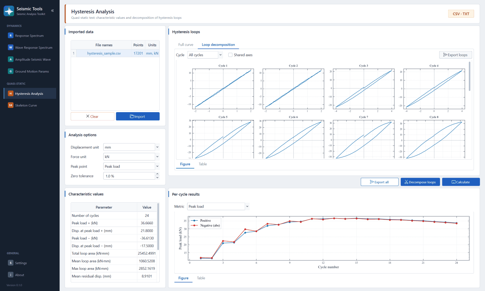

| 控件 | 说明 |
| --- | --- |
| Cycle | 选择 All cycles（全部圈，以子图网格排列）或单独某一圈 |
| Shared axes | 勾选后所有子图使用相同的坐标范围，便于比较各圈大小 |
| Export loops | 批量导出全部已加载曲线的拆解数据与图形（灰色按钮，仅针对拆解结果） |
| Figure / Table | 拆解图形 / 各圈数据（Cycle 圈号、Point 圈内点号、位移、力） |

在拆解图形上右键 → Save figure as image…，导出窗口中的 **Export** 选项可选择 **Combined figure**（全部圈合成一张图）或 **Separate files**（每圈单独一个文件）。在拆解表格上右键可导出当前选择的拆解数据。

### 8.6 导出

**Export all**（蓝色描边，页面级）可选内容：

| 内容 | 文件名 | 默认 |
| --- | --- | --- |
| Per-cycle results | `{名称}_cycles` | 勾选 |
| Characteristic values | `{名称}_summary` | 勾选 |
| Loop decomposition data | `{名称}_loops` | 不勾选 |
| Hysteresis data | `{名称}_hysteresis_data` | 不勾选 |
| Hysteresis curve | `{名称}_hysteresis` | 勾选 |
| Per-cycle charts | `{名称}_cycle_metrics`（五项指标 2×3 子图） | 勾选 |
| Loop decomposition | `{名称}_loops` 或 `{名称}_cycle_n` | 不勾选 |

批量导出窗口中的 **Loop figures** 选项可选择 All loops in one figure（每条曲线一张拆解总图）或 One file per loop（每圈一个文件）。

---

## 9. 骨架曲线（Skeleton Curve）

从滞回曲线中提取骨架曲线，并计算峰值点、极限点、等效屈服点与延性系数。

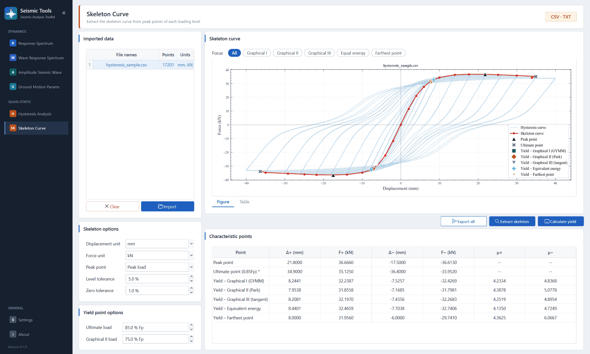

### 9.1 操作步骤

1. 导入滞回数据（与 Hysteresis Analysis 共用列表）。
2. 在 **Skeleton options** 中设置峰值点取法与容差，点击 **Extract skeleton** 提取骨架曲线。图中以浅色显示滞回曲线，红色折线为骨架曲线；Table 标签页列出骨架点（Point、Branch、Displacement、Force）。
3. 在 **Yield point options** 中设置极限点与 Park 法参数，点击 **Calculate yield**（未提取骨架曲线时会先自动提取）。图中标出峰值点（▲）、极限点（✕）及五种方法的屈服点，下方 **Characteristic points** 表格列出各点坐标与延性系数。
4. 通过 **Focus** 按钮组切换查看某一种方法：所选方法的作图辅助线高亮显示，其余元素变暗；选 **All** 显示全部方法。单击表格中某一屈服点所在行，也会聚焦到对应方法。

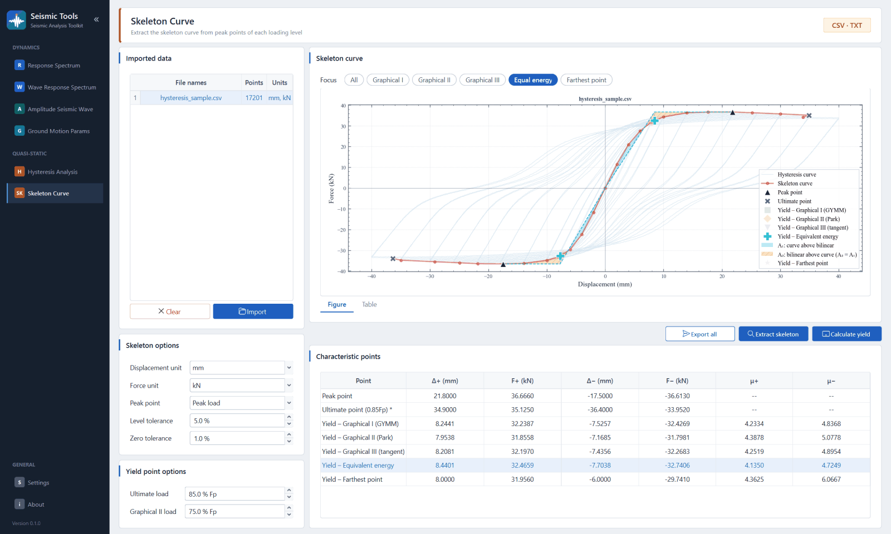

### 9.2 参数说明

#### Skeleton options

| 参数 | 说明 | 默认值 |
| --- | --- | --- |
| Displacement unit / Force unit | 显示单位 | 导入时的单位 |
| Peak point | 每级加载首个半圈峰值点的取法：Peak load 或 Peak displacement | Peak load |
| Level tolerance | 加载级判定容差：半圈幅值超过上一级幅值的 (1 + 容差) 倍时，视为新的加载级 | 5.0 % |
| Zero tolerance | 过零判定容差（同 [8.2 节](#82-分析参数)） | 1.0 % |

#### Yield point options

| 参数 | 说明 | 默认值 |
| --- | --- | --- |
| Ultimate load | 极限点：峰值后荷载下降至该比例的峰值荷载 Fp 时的点，范围 50%～100% | 85.0 % Fp |
| Graphical II load | 作图法二（Park 法）中 A 点的荷载比例，范围 10%～99% | 75.0 % Fp |

修改参数后，当前数据的已有结果自动重新计算。

### 9.3 骨架曲线提取方法

1. 按位移过零划分加载半圈（同滞回分析）。
2. 每个半圈的幅值 $\delta$ 取其最大位移绝对值。若 $\delta \le (1 + \varepsilon_L) \delta_{\mathrm{prev}}$，则视为同级重复加载，跳过；否则作为新的加载级。其中 $\varepsilon_L$ 为 Level tolerance，$\delta_{\mathrm{prev}}$ 为同方向上一加载级的幅值。
3. 取每一加载级**第一个半圈**的峰值点（按 Peak point 设置）。
4. 负向各点（由外向内）、原点、正向各点（由内向外）依次连接，构成骨架曲线。

### 9.4 特征点与屈服点算法

正、负两个方向分别计算（负向取反后按正向处理，表中仍以负值显示）。下文以 $D$、$F$ 表示骨架曲线的位移与荷载，$F(D)$ 表示骨架曲线在位移 $D$ 处的荷载（相邻骨架点之间线性插值）。

**峰值点** $(D_p, F_p)$：骨架曲线上荷载最大的点，荷载相同时取位移较大者。

**极限点** $(D_u, F_u)$：峰值点之后荷载首次降至 $F_u = \eta_u F_p$ 时的点（线性插值），$\eta_u$ 为 Ultimate load，默认 0.85。若试验未下降到该比例，则取骨架曲线最后一点，并在表中以 `*` 标注。

**初始刚度** $K_0$：骨架曲线自原点起第一段的斜率，$K_0 = F_1 / D_1$，$(D_1, F_1)$ 为原点后的第一个骨架点。

屈服点算法参考冯鹏等（2017），各方法与界面名称的对应关系如下：

| 方法 | 表中名称 | Focus 按钮 |
| --- | --- | --- |
| 作图法一（通用屈服弯矩法） | Graphical I (GYMM) | Graphical I |
| 作图法二（Park 法） | Graphical II (Park) | Graphical II |
| 作图法三（切线法） | Graphical III (tangent) | Graphical III |
| 等能量法 | Equivalent energy | Equal energy |
| 最远点法 | Farthest point | Farthest point |

#### 作图法一（通用屈服弯矩法）

初始切线 $F = K_0 D$ 与峰值荷载水平线 $F = F_p$ 交于 A；过 A 作竖线交曲线于 B；连 OB 并延长，与 $F = F_p$ 交于 C，C 点位移即屈服位移：

$$
D_A = \frac{F_p}{K_0}, \qquad F_B = F(D_A), \qquad D_y = D_C = \frac{F_p}{F_B} D_A
$$

#### 作图法二（Park 法）

取曲线上荷载为 $\eta_P F_p$ 的点 A（$\eta_P$ 为 Graphical II load，默认 0.75），连 OA 并延长，与 $F = F_p$ 交于 B，B 点位移即屈服位移：

$$
F(D_A) = \eta_P F_p, \qquad D_y = D_B = \frac{D_A}{\eta_P}
$$

#### 作图法三（切线法）

初始切线与峰值点前最后一段的切线交于 P，$(D', F')$ 为峰值点前一个骨架点：

$$
K_1 = \frac{F_p - F'}{D_p - D'}, \qquad D_P = \frac{F_p - K_1 D_p}{K_0 - K_1}, \qquad F_P = K_0 D_P
$$

过 P 作曲线的垂线，垂足即屈服点。垂距在归一化坐标 $(D/D_p, F/F_p)$ 中计算，结果与单位无关。该方法要求 $K_0 > K_1$。

#### 等能量法

以理想弹塑性二折线 $O \to (D_y, F_p) \to (D_p, F_p)$ 代替原曲线，令二折线与曲线（自原点至峰值点）下的面积相等：

$$
F_p D_p - \frac{1}{2} F_p D_y = A = \int_0^{D_p} F(D) \mathrm{d}D
\qquad \Rightarrow \qquad
D_y = \frac{2 \left( F_p D_p - A \right)}{F_p}
$$

图中以青色填充 $A_1$（曲线高于二折线的部分）、橙色斜线填充 $A_2$（二折线高于曲线的部分），两者面积相等。

#### 最远点法

曲线上距原点–峰值点连线最远的点为屈服点：

$$
d(D) = \frac{\lvert F_p D - D_p F(D) \rvert}{\sqrt{F_p^2 + D_p^2}}, \qquad D_y = \arg\max_{0 \le D \le D_p} d(D)
$$

若曲线近似直线，即归一化最大距离 $\max \lvert D/D_p - F/F_p \rvert / \sqrt{2} < 0.01$，则认为无明确屈服点。

#### 屈服荷载与延性系数

各方法得到的屈服位移取 $D_y \le D_p$，屈服荷载取骨架曲线上的对应荷载 $F_y = F(D_y)$（即屈服点位于曲线上）。延性系数为：

$$
\mu = \frac{D_u}{D_y}
$$

Characteristic points 表格列：Point、Δ+、F+、Δ−、F−、μ+、μ−。行依次为 Peak point、Ultimate point（比例 Fp）及五种方法的屈服点（Yield – 方法名）。

### 9.5 导出

**Export all** 可选内容（均默认勾选）：

| 内容 | 文件名 |
| --- | --- |
| Skeleton curve data | `{名称}_skeleton`（点号、分支、位移、力） |
| Characteristic points | `{名称}_yield_points` |
| Skeleton curve and yield points | `{名称}_skeleton`（图形，显示全部方法） |

图形与表格也可右键单独导出；图形导出保持当前的聚焦状态。

---

## 10. 滞回曲线修正（Hysteresis Correction）

> **试验功能**：本页面的算法与界面仍在完善，顶部栏的当前步骤后标注“（试验功能）”，结果请与其他手段核对。

拟静力试验中，竖向荷载由千斤顶施加。试验过程中柱顶发生侧移，竖向荷载随之产生 P–Δ 效应：或在柱底形成附加弯矩，或因竖向千斤顶倾斜而产生水平分力，使试验机测得的水平力不等于桥墩的基底剪力。本页面按所用的加载装置，利用竖向力逐点修正水平力，并对比修正前后的滞回曲线与特征值。

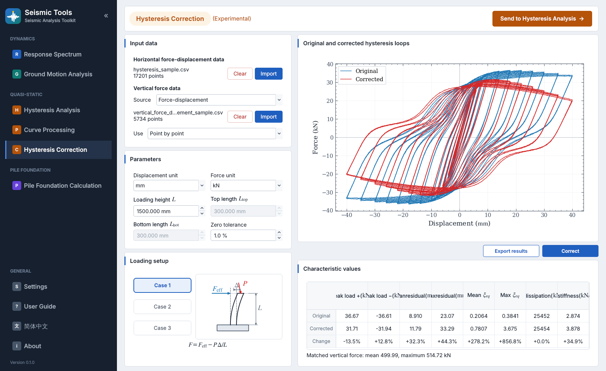

### 10.1 操作步骤

1. 在 **Input data → Horizontal force-displacement data** 中点击 **Import**，导入水平力–位移滞回曲线。每次只导入一个文件，导入新文件会替换原有文件，设置项见 [3.2 节](#32-滞回曲线文件)。
2. 在 **Vertical force data** 中用 **Source** 选择竖向力的来源：
   - **Force-displacement**：竖向力–位移曲线，文件含位移列与竖向力列；
   - **Time history**：竖向力时程曲线，文件只有竖向力一列；
   - **Constant**：直接输入恒定的竖向力（受压为正）。
   - 前两种来源点击右侧 **Import** 导入文件，各自保留一个文件，切换来源时分别显示；**Use** 选择竖向力的取值方式。
3. 在 **Parameters** 中设置显示单位、几何参数 $L$、$L_{\mathrm{top}}$、$L_{\mathrm{bot}}$ 与过零容差。当前装置用不到的几何参数自动变灰。
4. 在 **Loading setup** 中选择加载装置：点击左侧的 Case 1～Case 3，右侧显示对应的示意图，下方显示修正公式（见 [10.3 节](#103-三种加载装置与修正公式)）。
5. 点击 **Correct**。右上图叠加显示 Original（原始）与 Corrected（修正后）的滞回曲线，下方 **Characteristic values** 对比修正前后的特征值。此后修改数据、参数或装置，结果自动重新计算；参数无效或缺少数据时结果清空，补齐后再次点击 **Correct**。
6. 点击 **Export results** 导出数据（见 [10.6 节](#106-导出)）；也可以直接点击页面顶部的 **Send to Hysteresis Analysis**，把修正后的数据加入滞回数据列表，继续做滞回分析与骨架曲线。

### 10.2 参数说明

#### 竖向力

| 设置项 | 说明 | 默认值 |
| --- | --- | --- |
| Source | 竖向力来源：Force-displacement（力–位移曲线）、Time history（力时程曲线）、Constant（常数） | Force-displacement |
| Use | 竖向力取值方式：Point by point（逐点匹配到水平力曲线的每个数据点）、Mean value（取均值作为常数）、Maximum value（取幅值最大值，保留符号） | Point by point |
| 常数输入框 | Source 为 Constant 时显示，单位为所选的力单位 | 0 |

竖向力时程曲线文件只有一列力，**Load vertical force time history file** 导入窗口中不显示位移列、位移单位与位移系数（其余设置同 [3.2 节](#32-滞回曲线文件)）。

#### 参数（Parameters）

| 参数 | 说明 | 默认值 |
| --- | --- | --- |
| Displacement unit / Force unit | 显示单位。几何参数与常数竖向力按显示单位输入，切换单位时数值自动换算，物理量保持不变 | 导入时的单位 |
| Loading height $L$ | 底座顶面到水平加载点的距离 | 1000 mm |
| Top length $L_{\mathrm{top}}$ | 水平加载点向上到竖向千斤顶顶端的距离 | 300 mm |
| Bottom length $L_{\mathrm{bot}}$ | 底座顶面向下到竖向千斤顶下端的距离 | 300 mm |
| Zero tolerance | 过零判定容差，用于计算特征值时分圈（同 [8.2 节](#82-分析参数)） | 1.0 % |

各情况用到的几何参数见下表，用不到的参数自动变灰、不参与计算；用到的参数必须大于零，否则点击 **Correct** 时提示 “Parameter … must be greater than zero!”。

### 10.3 三种加载装置与修正公式

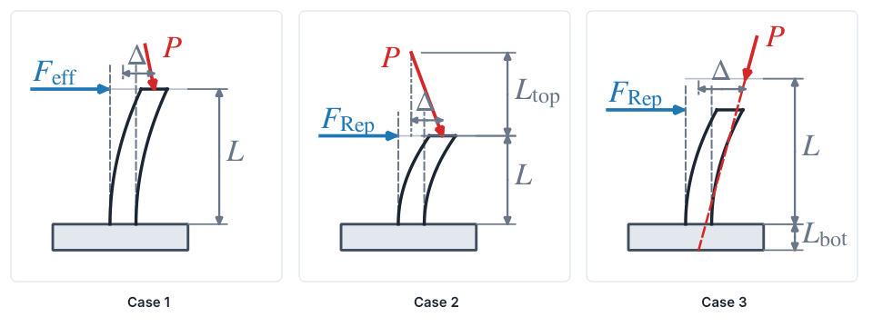

下表中 $\Delta$ 为水平位移，$P$ 为竖向力，$F$ 为修正后的基底剪力。$\Delta$、$F_{\mathrm{eff}}$、$F_{\mathrm{Rep}}$ 带符号，正负向对称处理；$P$ 以受压为正。若数据中受压记为负值，导入竖向力文件时将 **Force factor** 设为 −1。

| 情况 | 加载装置 | 试验力 | 使用的参数 | 修正公式 |
| --- | --- | --- | --- | --- |
| Case 1 | 竖向力随柱顶侧移倾斜作用在柱顶，水平力为装置的有效力 | $F_{\mathrm{eff}}$ | $L$ | $F = F_{\mathrm{eff}} - \dfrac{P \Delta}{L}$ |
| Case 2 | 水平千斤顶加载，竖向千斤顶上端固定在加载点上方 $L_{\mathrm{top}}$ 处，随柱顶侧移倾斜 | $F_{\mathrm{Rep}}$ | $L_{\mathrm{top}}$ | $F = F_{\mathrm{Rep}} + \dfrac{P \Delta}{L_{\mathrm{top}}}$ |
| Case 3 | 水平千斤顶加载，竖向力始终指向底座下沿的同一位置 | $F_{\mathrm{Rep}}$ | $L$、$L_{\mathrm{top}}$、$L_{\mathrm{bot}}$ | $F = F_{\mathrm{Rep}} - P \sin\alpha$，$\tan\alpha = \dfrac{\Delta (L + L_{\mathrm{top}}) / L}{L + L_{\mathrm{bot}} + L_{\mathrm{top}}}$ |

示意图的构图参照参考文献 19 的图 3.5 中的 (a)、(c)、(d) 三种装置。试验力本身就是基底剪力的装置（图中 (b)）无需修正，本页不处理。Case 2 的修正量取竖向千斤顶倾斜后产生的水平分力 $P \Delta / L_{\mathrm{top}}$（文献原式印作 $P L_{\mathrm{top}} / \Delta$，位移趋于零时修正量无限增大，与几何关系不符）；Case 3 的参数 $L_{\mathrm{top}}$ 为竖向力作用线上端参考线到水平加载点的距离，参考文献中的图未标出。

### 10.4 竖向力与水平力曲线的融合

水平力–位移曲线与竖向力数据的采样点数、位移精度可能不同，程序先把竖向力对齐到水平力曲线的每个数据点：

- **Force-displacement**：两条曲线描述同一加载过程。各自按位移累计行程 $s_i = \sum_{k \le i} \lvert \Delta_k - \Delta_{k-1} \rvert$ 除以总行程归一化到 0～1，再把竖向力按归一化行程线性插值到水平力曲线的每个数据点。归一化行程相同的数据点取平均；位移总行程为零时改按数据点序号。
- **Time history**：没有公共自变量，按相对序号 $i/(N-1)$ 对齐，假定竖向力记录与水平力曲线覆盖同一次完整试验。
- **Constant**：每个数据点取同一常数。

随后按 **Use** 处理：Point by point 保持逐点对应的竖向力；Mean value、Maximum value 分别取全部点的均值与幅值最大值，作为常数使用。

### 10.5 输出指标

**Characteristic values** 为转置表，每列一项特征值，三行分别为修正前（Original）、修正后（Corrected）与变化率（Change）：

| 列 | 含义 |
| --- | --- |
| Peak load + / Peak load − | 整条曲线正、负向最大荷载 |
| Mean residual / Max residual | 各圈平均残余位移的均值与最大值 |
| Mean ξeq / Max ξeq | 等效粘滞阻尼比的均值与最大值 |
| Energy dissipation | 滞回环面积之和（总耗能） |
| Mean stiffness | 割线刚度均值 |

变化率为 $(X_{\mathrm{corrected}} - X_{\mathrm{original}}) / \lvert X_{\mathrm{original}} \rvert \times 100\%$。各指标的计算方法同 [8.4 节](#84-计算方法)，峰值点按 Peak load 取。表格下方的 **Matched vertical force** 给出与水平力曲线对齐后的竖向力均值与最大幅值。

### 10.6 导出

- **Export results**：打开表格导出窗口，导出每个数据点的 Point（点号）、Displacement、Original force、Vertical force 与 Corrected force（均为当前显示单位）。尚未修正时先自动修正。
- 图形右键 → Save figure as image…，导出修正前后的滞回曲线。
- 特征值表右键 → Export table data…，导出的表格与界面一致（每列一项特征值）。

本页面不提供 Export all 批量导出。

---

## 11. 试验曲线处理（Test Curve Processing）

> **试验功能**：本页面的算法与界面仍在完善，顶部栏的当前步骤后标注“（试验功能）”，请在时程图中逐段确认检测结果。

拟静力试验中途停机、调整设备或保载时，位移保持不变，位移时程曲线上表现为水平段，期间力可能因松弛而变化，在滞回曲线上留下与加载无关的竖向线。本页面检测这些等待段，由用户逐段选择是否剔除，并对比处理前后的滞回曲线与时程曲线。

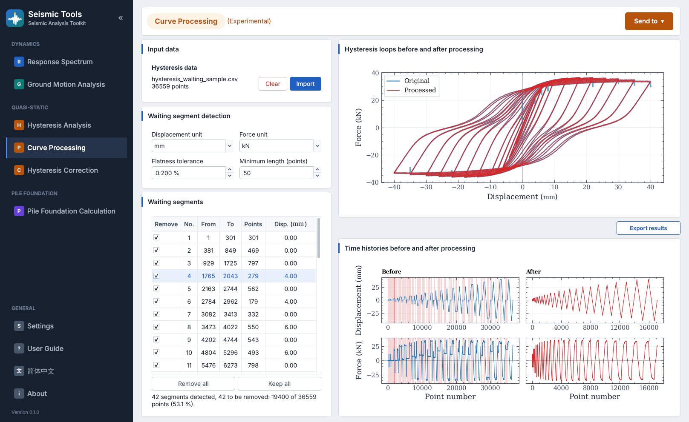

### 11.1 操作步骤

1. 在 **Input data → Hysteresis data** 中点击 **Import**，导入滞回曲线（位移–力，每次一个文件，导入新文件会替换原有文件，设置项见 [3.2 节](#32-滞回曲线文件)）。
2. 在 **Waiting segment detection** 中设置显示单位、**Flatness tolerance** 与 **Minimum length (points)**。导入数据或修改这两个参数后自动重新检测，检出的等待段默认全部剔除。
3. **Waiting segments** 列表逐行列出检出的等待段，勾选 **Remove** 表示剔除、取消勾选表示保留；**Remove all**、**Keep all** 一次性全选或全不选。列表下方汇总检出段数、拟剔除的段数与数据点数。
4. 单击列表中的某一行，该段在时程图中以较深的底色标出，便于核对。
5. 右上图 **Hysteresis loops before and after processing** 叠加显示处理前（Original，较粗的浅蓝色）与处理后（Processed，红色）的滞回曲线，被剔除段留下的竖向线只出现在 Original 中。
6. 右下图 **Time histories before and after processing** 为 2×2 子图：上行位移时程，下行力时程；左列 Before 为处理前（等待段以底色标出：红色为拟剔除，灰色为保留，选中行颜色更深），右列 After 为处理后。横轴为数据点序号，处理后的点号重新从 1 编排；两列共用纵轴范围。
7. 点击 **Export results** 导出处理后的数据（见 [11.3 节](#113-导出与说明)）；也可以直接用页面顶部的 **Send to** 菜单，把处理后的数据发送到 Hysteresis Correction 或 Hysteresis Analysis，继续后面的步骤。

### 11.2 检测与剔除方法

设位移序列为 $d_1, d_2, \dots, d_N$，最大位移幅值 $d_{\max} = \max_i \lvert d_i \rvert$，**Flatness tolerance** 为 $\varepsilon$（占 $d_{\max}$ 的百分比，默认 0.2 %），**Minimum length** 为 $n_{\min}$（默认 50 点）。对由连续 $n_{\min}$ 个数据点构成的每个窗口 $W$，若

$$
\max_{k \in W} d_k - \min_{k \in W} d_k \le \varepsilon \, d_{\max}
$$

则 $W$ 为静止窗口。相互重叠的静止窗口合并为一个**等待段**，其长度不小于 $n_{\min}$。检测不区分位移所处的位置，零位移处的停机与峰值处的保载都会被检出。

被选中的等待段内的全部数据点从数据中删除，其余数据点保持原有顺序。等待段两端的位移基本相同，处理后的滞回曲线不会出现位移跳变；等待期间力的松弛（滞回曲线上的竖向线）一并去除，等待段前后相邻的两个力值之间可能存在跳变。

参数调整建议：

- 位移测量噪声较大、水平段未被检出时，增大 Flatness tolerance；
- 加载速率很慢时，缓慢的单向加载也可能满足容差而被误检，此时减小 Flatness tolerance 或增大 Minimum length，并在时程图中确认；
- 只想剔除较长的等待、保留短暂停顿时，增大 Minimum length。

### 11.3 导出与说明

- **Export results**：打开表格导出窗口，导出处理后的数据：第一列 Point 为该数据点在原始数据中的序号，其后为 Displacement、Force（当前显示单位）。
- 图形右键 → Save figure as image…；等待段列表右键 → Export table data…，导出每个等待段的 No.、Start、End、Points、Displacement（位移均值）与 Removed。
- 本页面的数据独立管理，不与其他拟静力页面共享；处理后导出的文件可在 Hysteresis Analysis 等页面导入分析。
- 数据不含时间列，时程图的横轴为数据点序号。
- 带等待段的示例数据见 [3.3 节](#33-示例数据)：`hysteresis_waiting_sample.csv` 在默认参数下检出 42 个等待段，共 19 400 个数据点（占 53.1 %）。

---

## 12. 桩基础（Pile Foundation）

侧边栏的 **PILE FOUNDATION**（桩基础）分组用于桩基的手算校核与有限元建模准备，包含四个页面：单桩与群桩的轴向承载力、m 法桩身弯矩剪力分布、有限元桩基模拟用的六自由度弹簧刚度，以及桩身、桩侧、桩端的分布弹簧刚度。计算方法取自《桥梁墩台与基础工程》第五章（m 法）及其附录 A、B，符号与该书一致，单位为 kN、m、kPa。

> **使用提示**：承载力的各类系数表取自旧版《铁路桥涵地基和基础设计规范》（TB 10002.5-2005），正式设计请以现行规范为准，本页面更适合方案比选、教学与有限元模型的参数准备。

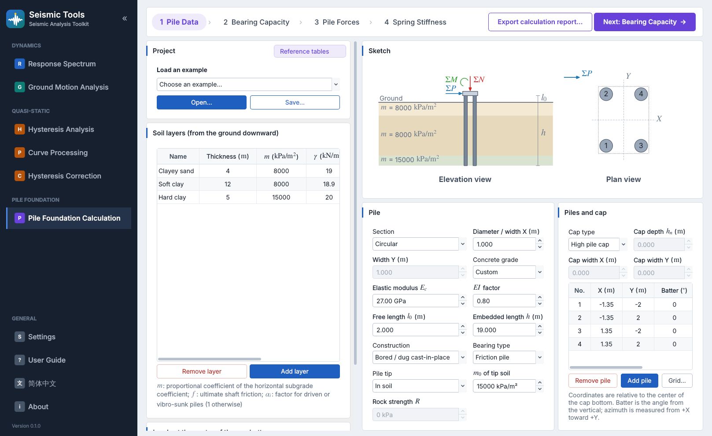

### 12.1 页面与数据共享

| 页面 | 折叠后简称 | 主要功能 |
| --- | --- | --- |
| Pile Data | Pile Data | 输入桩截面、土层、桩位、承台与荷载，显示立面图与平面图，保存或打开工程文件，导出 PDF 计算书 |
| Bearing Capacity | Capacity | 八种方法计算单桩轴向容许承载力，群桩效率与实体基础验算，桩顶最大轴力校核 |
| Pile Forces | Forces | m 法计算承台位移、各桩桩顶内力，以及桩身弯矩、剪力、位移与土抗力的深度分布 |
| Spring Stiffness | Springs | 群桩或单桩的 6×6 刚度矩阵，以及沿桩身的水平、竖向分布弹簧与桩端弹簧 |

四个页面共用 Pile Data 页中的同一份桩基模型，页面顶部的步骤条按 1 到 4 的顺序列出这四步，输完数据后点击 **Next** 即可进入下一页，无需回到侧边栏。该页任何输入改变后，其他页面中已有的计算结果会被清除，需要重新点击 **Calculate**。Pile Forces 页算出各桩桩顶轴力后，Bearing Capacity 页会用其中的最大值 $N_{\max}$ 与单桩容许承载力 $[P]$ 比较。

### 12.2 Pile Data：桩基数据

页面左侧是 **Project**（工程）、**Soil layers**（土层）与 **Loads**（荷载），右侧上方是示意图（立面图与平面图左右排布），下方是 **Pile**（桩）与 **Piles and cap**（桩位与承台）。

**Project**

- **Load an example**：载入两个算例（算例一为单排双桩，算例二为高桩承台 2×2 桩），用于熟悉输入格式和核对结果（见 [12.7 节](#127-算例核对)）。
- **Open… / Save…**：读写 JSON 工程文件，保存全部输入。
- **Reference tables**：点击 Project 区右上角的信息卡，查阅 $m$、$m_0$ 取值，钻孔桩与打入（沉）桩的桩侧摩阻力、桩端土承载力，以及钻孔桩的修正系数等参考表格。窗口顶部的“参考规范”下拉框可在内置的 TB 10093-2017《铁路桥涵地基和基础设计规范》（默认）与 JTG 3363-2019《公路桥涵地基与基础设计规范》之间切换，表格下方注明数据来源与使用条件。也可以在工作目录的 `Reference Codes` 文件夹中放入 `.json` 文件增加其他规范（文件格式见 `src/utils/pile_reference.py` 开头的说明），窗口打开时自动读取。

**Pile**

| 输入项 | 说明 |
| --- | --- |
| Section | 圆形或矩形。矩形桩的 Y 向宽度单独输入 |
| Diameter / width X | 圆桩直径，矩形桩沿 X 向的宽度。钻孔桩取成孔直径 |
| Concrete grade / Elastic modulus Ec | 选择 C20 至 C50，自动给出 $E_c$；选择 Custom 时可直接输入 |
| EI factor | 抗弯刚度 $EI = \text{系数} \times E_c I$，TB 10002.5-2005 取 0.8 |
| Free length l0 | 桩顶（承台底）高出地面或局部冲刷线的高度 $l_0$，低桩承台取 0 |
| Embedded length h | 桩在地面或局部冲刷线以下的入土长度 $h$ |
| Construction | 钻（挖）孔灌注桩，或打入、振动下沉桩，影响轴向刚度的系数 $\xi$ |
| Bearing type | 摩擦桩或端承桩 |
| Pile tip | 桩端位于土中、岩面上，或嵌入岩层，决定桩端边界条件 |
| m0 of tip soil | 桩底土竖向地基系数的比例系数 $m_0$，0 表示取最下一层土的 $m$ |
| Rock strength R | 桩端为岩石时的饱和单轴抗压强度，用于查竖向地基系数 $C_0$ |

**Soil layers**：自地面向下逐层输入名称、厚度、$m$、重度 $\gamma$、内摩擦角 $\varphi$、桩侧极限摩阻力 $f$ 与打入桩影响系数 $\alpha_i$。最后一层向下延伸至桩底。$m$ 用于桩身内力和弹簧刚度，$\gamma$、$\varphi$ 用于群桩验算，$f$、$\alpha_i$ 用于承载力。

**Piles and cap**

- 桩位表：每根桩的 X、Y 坐标（以承台底面中心为原点）、**Batter**（与竖直方向的夹角）与 **Azimuth**（倾斜方向，自 +X 向 +Y 量取）。**Grid…** 一次生成矩形阵列。
- **Cap type**：高桩承台（桩顶在地面以上）或低桩承台。低桩承台需输入承台埋深 $h_n$ 与两个方向的承台宽度，用于计入承台侧面土抗力。

**Loads**：承台底面中心处的 $\Sigma N$、$\Sigma P$、$\Sigma M$ 与 **Loading direction**（沿 X 或沿 Y）。示意图中的立面图（水平力所在平面）与平面图随输入实时更新，图名标在各图下方，立面图中的 $m$ 标注各层土的比例系数。

#### 符号约定

- 平面分析（Pile Forces 页）的坐标：x 向右，y 向下。$\Sigma N$ 向下为正，$\Sigma P$ 沿加载方向为正，$\Sigma M$ 与 $\Sigma P$ 同向转动为正（力指向右时顺时针为正）。
- 承台位移 $a$（水平）、$b$（竖向，向下为正）、$\beta$（转角，顺时针为正）。
- 桩的倾角 $\varphi$：桩底偏向加载方向为正。斜桩在加载平面内的投影倾角由 Batter 与 Azimuth 换算。
- Spring Stiffness 页的总体坐标：X、Y 水平，Z 向上，右手系，转角按右手法则，自由度顺序为 UX、UY、UZ、RX、RY、RZ。

### 12.3 Bearing Capacity：承载力

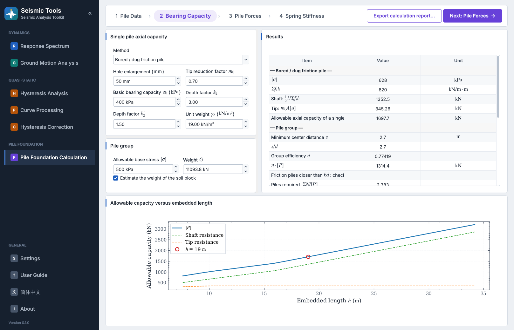

**Single pile axial capacity**：在 Method 中选择计算方法，页面按所选方法自动列出输入项。桩周长 $U$、桩底面积 $A$ 取自桩截面（钻孔桩的 $U$ 按 Hole enlargement 增大后的成孔直径计算），各层的 $f_i$、$l_i$ 取自 Pile Data 页的土层与入土深度。

| 方法 | 公式 |
| --- | --- |
| 钻（挖）孔摩擦桩（式 5-57） | $[P] = \tfrac12 U \sum f_i l_i + m_0 A [\sigma]$ |
| 打入、振动下沉摩擦桩（式 5-58） | $[P] = \tfrac12 \left( U \sum \alpha_i f_i l_i + \lambda A R \alpha \right)$ |
| 嵌岩端承桩（式 5-59） | $[P] = R \,(C_1 A + C_2 U h)$，$h \le 0.5\ \mathrm{m}$ 时 $C_1$ 乘 0.7、$C_2$ 取 0 |
| 打入岩层的端承桩（式 5-60） | $[P] = C R A$，$C = 0.45$（均匀岩石）或 0.3（裂隙、风化岩层） |
| 摩擦桩抗拔（式 5-61） | $[P'] = 0.3\, U \sum \alpha_i l_i f_i$ |
| 静载试验（式 5-62） | $[P] = P_j / K$ |
| 静力触探（式 5-63 至 5-66） | $[P] = \tfrac12 (U \sum \alpha_i f_i l_i + \lambda A R \alpha)$，$f_i = \beta_i \bar f_{si}$，$R = \beta \bar q_c$ |
| 桩身材料与压屈（式 5-67） | $[P] = \varphi\,[\sigma_c]\,(A_c + m A_s')$ |

钻孔桩的桩底容许承载力 $[\sigma]$ 按桩底埋深分三段计算：$h \le 4d$ 时 $[\sigma] = \sigma_0 + k_2 \gamma_2 (h-3)$；$4d < h \le 10d$ 时 $[\sigma] = \sigma_0 + k_2\gamma_2(4d-3) + k_2'\gamma_2 (h-4d)$；$h > 10d$ 时 $h-4d$ 取 $6d$。静力触探法中，$\beta_i$、$\beta$ 按式 (5-65)、(5-66) 的两组公式取值：端阻力平均值大于 2000 kPa 且摩阻比不大于 0.014 时用第一组，否则用第二组。桩身材料验算的纵向弯曲系数 $\varphi$ 由桩的计算长度（表 5-16）与长细比查表 5-15 并线性插值。

结果表列出各中间量与最后的 $[P]$，右下图给出 $[P]$、桩侧与桩端分量随入土深度的变化，红色圆圈为当前入土深度。

**Pile group**

- **Allowable base stress [σ]**：桩底平面处土的容许承载力，用于实体基础验算。**Estimate the weight of the soil block** 勾选时，桩底平面以上承台、土体与桩的重量按各层重度估算，取消勾选后可直接输入 $G$。
- 桩中心最小间距 $s$ 与 $s/d$；群桩效率 $\eta = 1 - \dfrac{\arctan(d/s)}{90^\circ}\cdot\dfrac{(n-1)m + (m-1)n}{mn}$（式 5-68），其中 $m$、$n$ 为桩的列数和每列桩数，由桩位的不同 X、Y 坐标统计。
- 摩擦桩中心距小于 $6d$ 时，按实体基础检算桩底应力：桩底平面由各桩外缘向外扩 $h \tan(\bar\varphi/4)$，$\sigma_{\max,\min} = N/A \pm M/W$（式 5-69），$\bar\varphi$ 为各层内摩擦角按厚度的加权平均值（式 5-70），桩底弯矩 $M = \Sigma M + \Sigma P\,(l_0 + h)$。
- 先在 Pile Forces 页计算后，页面显示 $N_{\max} \le [P]$ 的校核结果。

### 12.4 Pile Forces：桩身内力（m 法）

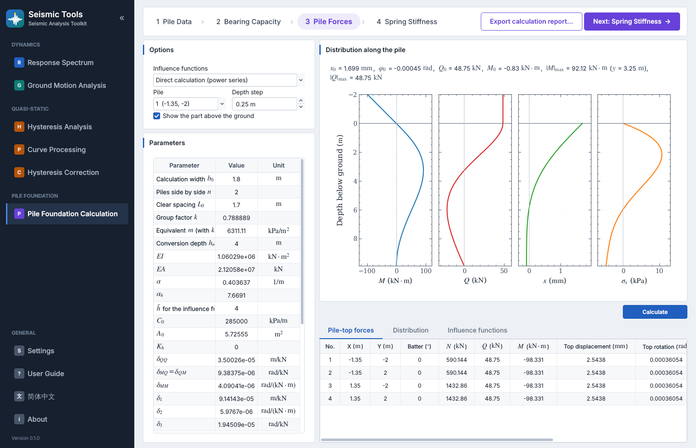

#### 操作步骤

1. 在 Pile Data 页输入或载入模型。
2. 在 **Influence functions** 中选择影响函数的取值方法（见 [12.6 节](#126-影响函数的两种取值方法)）。
3. 点击 **Calculate**。左侧 **Parameters** 表给出全部中间参数，右上图为所选桩的 $M$、$Q$、$x$、$\sigma_x$ 沿深度的分布，下方三个标签页依次为各桩桩顶内力、分布数值表与各深度的影响函数值。
4. 用 **Pile** 切换要查看的桩，**Depth step** 设置分布表的深度间隔，**Show the part above the ground** 控制图与表是否包含地面以上的自由段。

#### 计算方法

**1. 桩的计算宽度与变形系数。** 桩侧水平抗力 $\sigma_x = C_y x$，$C_y = m y$。桩的计算宽度

$$
b_0 = K_f K_0 d,\qquad K_0 = \begin{cases} 1 + 1/d, & d \ge 1 \\ 1.5 + 0.5/d, & d < 1 \end{cases}
$$

圆形桩 $K_f = 0.9$，矩形桩 $K_f = 1$。垂直于水平力方向并排 $n$ 根桩时，取 $K_f K_0 d$ 与 $(D'+1)/n$ 中的较小者，$D'$ 为这排桩两端外缘线的间距。变形系数

$$
\alpha = \left( \frac{m\, b_0}{EI} \right)^{1/5},\qquad EI = 0.8\, E_c I
$$

多层土按 $h_m$ 深度内横向地基系数曲线面积相等换算：$\bar m = \sum m_i (z_{b,i}^2 - z_{a,i}^2) / h_m^2$，先假定 $\alpha h > 2.5$ 取 $h_m = 2(d+1)$，不满足时改取 $h_m = h$。前后排桩的相互影响通过系数 $k$ 计入（乘在 $m$ 上）：作用力方向上有 $n$ 根桩、净距为 $L_0$ 时，$L_0 < 0.6 h_0$ 取 $k = C + \dfrac{1-C}{0.6}\dfrac{L_0}{h_0}$，否则 $k = 1$，其中 $h_0 = 3(d+1)$，$C = 1,\ 0.6,\ 0.5,\ 0.45$ 分别对应 $n = 1,\ 2,\ 3,\ \ge 4$。

**2. 桩身初参数解。** 令 $t = \alpha y$，挠曲线方程化为 $x'''' = -t\,x$。深度 $y$ 处的位移、转角、弯矩、剪力为

$$
\begin{aligned}
x_y &= x_0 A_1 + \tfrac{\varphi_0}{\alpha} B_1 + \tfrac{M_0}{\alpha^2 EI} C_1 + \tfrac{Q_0}{\alpha^3 EI} D_1 \\
\tfrac{\varphi_y}{\alpha} &= x_0 A_2 + \tfrac{\varphi_0}{\alpha} B_2 + \tfrac{M_0}{\alpha^2 EI} C_2 + \tfrac{Q_0}{\alpha^3 EI} D_2 \\
\tfrac{M_y}{\alpha^2 EI} &= x_0 A_3 + \tfrac{\varphi_0}{\alpha} B_3 + \tfrac{M_0}{\alpha^2 EI} C_3 + \tfrac{Q_0}{\alpha^3 EI} D_3 \\
\tfrac{Q_y}{\alpha^3 EI} &= x_0 A_4 + \tfrac{\varphi_0}{\alpha} B_4 + \tfrac{M_0}{\alpha^2 EI} C_4 + \tfrac{Q_0}{\alpha^3 EI} D_4
\end{aligned}
$$

土面处（$y = 0$）的 $x_0$、$\varphi_0$ 由桩底边界条件求得：桩底在土中或支承于岩面上时令桩底剪力为零、弯矩等于桩底土抗力矩 $-C_0 \varphi_h I_0$（用 $K_h = C_0 I_0 / (\alpha EI)$ 表示）；嵌入岩层时令桩底位移与转角为零。$\alpha h \ge 2.5$（岩面上为 3.5）时 $K_h$ 取 0。$\bar h = \alpha h$ 大于 4 时按 4 取值。由此得到土面处的柔度 $\delta_{QQ}$、$\delta_{MQ} = \delta_{QM}$、$\delta_{MM}$，且

$$
x_0 = Q_0 \delta_{QQ} + M_0 \delta_{QM},\qquad \varphi_0 = -(Q_0 \delta_{MQ} + M_0 \delta_{MM})
$$

**3. 桩顶刚度系数。** 桩顶高出地面 $l_0$ 时，桩顶柔度

$$
\delta_1 = \frac{l_0^3}{3EI} + \delta_{MM} l_0^2 + 2\delta_{MQ} l_0 + \delta_{QQ},\quad
\delta_2 = \frac{l_0}{EI} + \delta_{MM},\quad
\delta_3 = \frac{l_0^2}{2EI} + \delta_{MM} l_0 + \delta_{MQ}
$$

令 $\Delta = \delta_1 \delta_2 - \delta_3^2$，则 $\rho_2 = \delta_2/\Delta$，$\rho_3 = \delta_3/\Delta$，$\rho_4 = \delta_1/\Delta$。轴向刚度系数

$$
\rho_1 = \frac{1}{\dfrac{l_0 + \xi h}{EA} + \dfrac{1}{C_0 A_0}}
$$

$\xi$ 对端承桩取 1，钻孔摩擦桩取 1/2，打入摩擦桩取 2/3。桩底竖向地基系数 $C_0$：岩石按饱和单轴抗压强度 $R$ 在表 5-2 中插值（$R \le 1000$ kPa 取 $3 \times 10^5$ kPa/m，$R \ge 25000$ kPa 取 $1.5 \times 10^7$ kPa/m）；非岩石土 $h \le 10$ m 取 $10 m_0$，$h > 10$ m 取 $m_0 h$。桩底受力面积 $A_0$：端承桩取桩截面积，摩擦桩自桩侧四周按 $\bar\varphi/4$ 向下扩散到桩底，且不超过按桩中心距计算的面积。

**4. 群桩的位移法。** 把承台视为刚体，承台位移 $(a, b, \beta)$ 与荷载 $(\Sigma P, \Sigma N, \Sigma M)$ 的关系为 $\mathbf{K}\,(a, b, \beta)^{\mathrm T} = (\Sigma P, \Sigma N, \Sigma M)^{\mathrm T}$。每根桩在桩轴局部坐标中的刚度矩阵

$$
\mathbf{K}'_i = \begin{bmatrix} \rho_2 & 0 & -\rho_3 \\ 0 & \rho_1 & 0 \\ -\rho_3 & 0 & \rho_4 \end{bmatrix}
$$

经坐标转换 $\mathbf{T}_i = \begin{bmatrix} \cos\varphi & -\sin\varphi & -x_i\sin\varphi \\ \sin\varphi & \cos\varphi & x_i\cos\varphi \\ 0 & 0 & 1 \end{bmatrix}$ 叠加，$\mathbf{K} = \sum \mathbf{T}_i^{\mathrm T} \mathbf{K}'_i \mathbf{T}_i$（高桩承台时与式 5-35 的闭式一致）。低桩承台再加入承台侧面的土抗力项：$b_0 A_c$、$b_0 S_c$、$b_0 I_c$，其中 $A_c = C_n h_n/2$，$S_c = C_n h_n^2/6$，$I_c = C_n h_n^3/12$，$C_n = m h_n$，$b_0$ 为承台垂直于加载方向的宽度。

**5. 桩顶内力与桩身分布。** 解出 $(a, b, \beta)$ 后，第 $i$ 根桩桩顶在桩轴局部坐标中的位移为 $a' = a\cos\varphi - (b + x\beta)\sin\varphi$、$b' = a\sin\varphi + (b + x\beta)\cos\varphi$，内力为

$$
Q' = \rho_2 a' - \rho_3 \beta,\qquad N' = \rho_1 b',\qquad M' = -\rho_3 a' + \rho_4 \beta
$$

再换回结构坐标得到 $N$、$Q$。土面处 $Q_0 = Q'$，$M_0 = M' + Q'\, l_0/\cos\varphi$，代入初参数解即得桩身的 $x$、$\varphi$、$M$、$Q$。桩侧土抗力 $\sigma_x = m k\, y\, x$。分布深度取 $\min(h,\ 4/\alpha)$，更深处的内力可视为零。

#### 输出

- **Parameters**：$b_0$、$n$、$L_0$、$k$、$\bar m$、$h_m$、$EI$、$EA$、$\alpha$、$\alpha h$、$C_0$、$A_0$、$K_h$，柔度 $\delta$、刚度系数 $\rho_1 \sim \rho_4$，总刚度矩阵元素 $\gamma_{aa}$ 等，以及承台位移 $a$、$b$、$\beta$。
- **Pile-top forces**：各桩的坐标、倾角、$N$、$Q$、$M$、桩顶位移与转角、土面处的 $Q_0$、$M_0$。
- **Distribution**：深度、$\alpha y$、$x$、$\varphi$、$M$、$Q$、$\sigma_x$，地面以上的部分以负深度列出，只有 $M$、$Q$ 有值。
- **Influence functions**：各深度下 $A_1 \sim D_4$ 的十六个数值，便于与手算对照。

### 12.5 Spring Stiffness：弹簧刚度

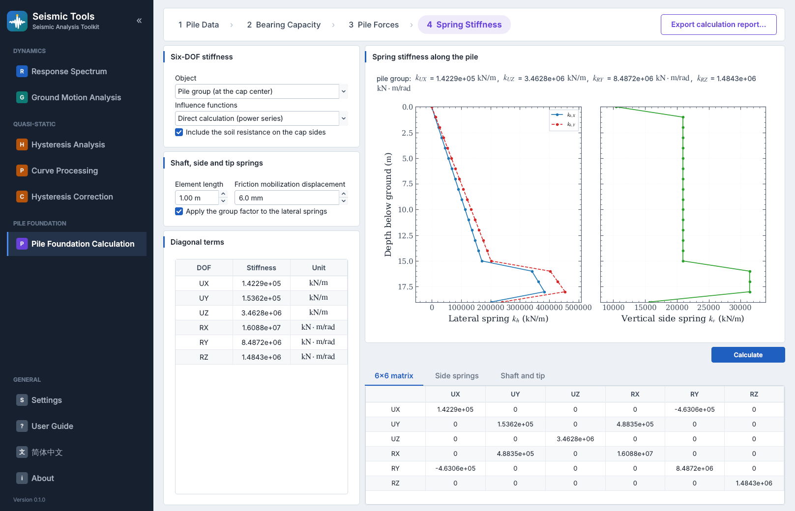

本页为有限元模型提供两类数据：桩顶的六自由度刚度矩阵，以及沿桩身的分布弹簧。

#### 六自由度刚度矩阵

**Object** 选择 **Pile group**（群桩，矩阵作用于桩顶标高处的承台中心，坐标原点即 Pile Data 页的承台底面中心）或 **Single pile**（单桩桩顶，竖直桩、桩位在原点、不计群桩效应）。点击 **Calculate** 后在 **6×6 matrix** 标签页显示矩阵，左下 **Diagonal terms** 单独列出对角项及单位，前三项为平动刚度（kN/m），后三项为转动刚度（kN·m/rad）。

计算方法：

1. 对每根桩，分别以 X 向、Y 向为加载方向取 $m$ 法参数，得到两个方向的 $\rho_1 \sim \rho_4$。竖直桩的桩顶矩阵中，$k_{UZ} = \rho_1$，$k_{UX} = k_{UY} = \rho_2$，$k_{RX} = k_{RY} = \rho_4$，平动与转动的耦合项 $k_{UX,RY} = -\rho_3$、$k_{UY,RX} = +\rho_3$。斜桩先在桩轴坐标中建立，再按 Batter 与 Azimuth 转换到总体坐标。
2. 绕桩轴的扭转刚度 $k_{RZ} = G J / (l_0 + L_t)$，$G = E_c/[2(1+\nu)]$，$J$ 为截面抗扭常数（圆形 $\pi d^4/32$），$L_t$ 为土中有效嵌固深度，取 $\min(h,\ 2/\alpha)$。**所依据的规范和资料没有给出扭转刚度，这一项是程序的假定**，仅供估算。
3. 各桩桩顶矩阵经刚体连接矩阵平移到承台中心后叠加。低桩承台再加入承台侧面土抗力对应的项（勾选 **Include the soil resistance on the cap sides** 时）。

#### 桩身、桩侧与桩端弹簧

按 **Element length** 把入土长度划分成单元（单元不跨越土层界面），每个节点给出：

| 弹簧 | 取值 |
| --- | --- |
| 桩侧水平弹簧 $k_h$（X 向、Y 向） | $k_h = m\, z\, k\, b_0\, \Delta l$，$z$ 为节点深度，$\Delta l$ 为节点影响长度，$m$ 取节点所在土层，$k$ 为群桩影响系数（勾选 **Apply the group factor k to the lateral springs** 时才计入，单桩不计） |
| 桩侧竖向弹簧 $k_v$ | $k_v = f\, U\, \Delta l / s$，$f$ 为该层桩侧极限摩阻力，$U$ 为桩周长，$s$ 为 **Friction mobilization displacement**（极限摩阻力充分发挥所需的相对位移） |
| 桩身轴向弹簧 | $EA/\Delta l$ |
| 桩端竖向弹簧 | $C_0 A_0$ |
| 桩端转动弹簧 | $C_0 I_0$，$I_0$ 取桩截面惯性矩 |

**极限摩阻力发挥位移 $s$ 是假定值**，默认 6 mm，常见范围 4 至 10 mm，规范没有给出，需要按地质条件和试桩结果调整。弹簧刚度是割线刚度，按线弹性使用。图中左图为 X 向、Y 向水平弹簧随深度的变化，右图为竖向弹簧。**Side springs** 标签页列出各节点的深度、土层、$m$、$C_y$、$k_h$、$k_v$、桩身刚度与极限摩阻力，**Shaft and tip** 标签页列出 $EA$、$EI$、$GJ$、桩端弹簧和汇总值。

> 把桩顶的六自由度矩阵放入有限元模型时，须确认建模软件的坐标轴方向与本页一致（Z 向上），竖向受压时桩顶向下位移，对应 UZ 为负。不同方向的轴线和转角定义不同的软件需要先变换。

### 12.6 影响函数的两种取值方法

Pile Forces 与 Spring Stiffness 两页都提供 **Influence functions** 选项：

- **Direct calculation (power series)**：直接求解 $x'''' = -t\,x$ 的幂级数解，$x = \sum a_n t^n$，递推 $a_{n+4} = -a_{n-1} / [(n+1)(n+2)(n+3)(n+4)]$，$a_4 = 0$，四组初值依次得到 $A_1 \sim D_1$，求导得到 $A_2 \sim D_4$。级数在双精度下收敛，没有表格间隔的插值误差。两种方法都按该书规定把 $\bar h$ 限制在 4 以内。
- **Table lookup (linear interpolation)**：查《桥梁墩台与基础工程》附录 B 的数值表（$\bar h = 0 \sim 4.0$，共 28 行）并线性插值。$\bar h > 4$ 时按 4 取值。适合与手算和算例对照。

两种方法在算例中的结果相差不超过 0.1 %。默认使用直接计算，需要与附录 B 或手算对照时再切换到查表法。

### 12.7 算例核对

两个算例可通过 Pile Data 页的 **Load an example** 载入，下表为程序结果与手算结果的比较。

| 项目 | 手算 | 程序 |
| --- | --- | --- |
| 算例一：$\alpha$ | 0.4232 | 0.4232 |
| $\delta_{QQ}$、$\delta_{MQ}$、$\delta_{MM}$ | $3.039\times10^{-5}$、$0.8566\times10^{-5}$、$0.3907\times10^{-5}$ | $3.036\times10^{-5}$、$0.8535\times10^{-5}$、$0.3901\times10^{-5}$ |
| $x_0$（m）、$\varphi_0$（rad） | 0.004603、-0.001835 | 0.004590、-0.001831 |
| 最大弯矩（kN·m） | 407.6（深度 1.4 m 附近） | 407.5（深度 1.4 m 附近） |
| 算例二：$\alpha$、$k$ | 0.4036（$\alpha h = 7.67$）、0.789 | 0.4036、0.789 |
| $\rho_1$、$\rho_2$、$\rho_3$、$\rho_4$ | $8.66\times10^{5}$、$0.357\times10^{5}$、$1.162\times10^{5}$、$5.459\times10^{5}$ | $8.657\times10^{5}$、$0.356\times10^{5}$、$1.158\times10^{5}$、$5.441\times10^{5}$ |
| 承台位移 $a$（cm）、$\beta$（rad） | 0.2539、$36.04\times10^{-5}$ | 0.2544、$36.05\times10^{-5}$ |
| $N_{\max}$、$N_{\min}$、$Q$、$M$ | 1432.4、590.6、48.76、-98.29 | 1432.9、590.1、48.75、-98.33 |

差异来自手算中间值的取位。

### 12.8 计算书导出

点击桩基础任一页面顶部栏右侧的 **Export calculation report...**，先在弹出的对话框中勾选要导出的内容，再选择保存位置，即可生成 PDF 格式的桩基础计算书。计算书按四个桩基页面**当前的设置**生成，包括 Bearing Capacity 页选择的承载力方法与参数、Pile Forces 页的影响函数取值方法与所显示的桩、Spring Stiffness 页的对象与弹簧参数。生成前请先在各页面确认设置，Pile Forces 页无需先点击 Calculate。

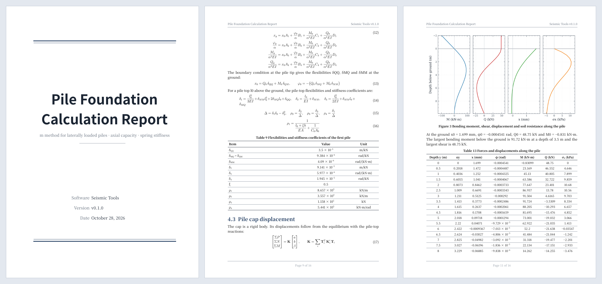


对话框中可以单独勾选总则、输入数据、轴向承载力、水平受力分析、弹簧刚度和结果汇总六个部分，也可以用 **Select all** 与 **Clear all** 一次全选或清空。封面和目录始终包含，目录只列出所选的部分。结果汇总只列出已选计算部分的结果，所以没有选中轴向承载力、水平受力分析或弹簧刚度时，该项不可选。除结果汇总外至少要选一项，否则不能继续。默认勾选的内容取决于从哪一页打开：只勾选到当前步骤为止的内容，例如在 Bearing Capacity 页打开时，勾选总则、输入数据、轴向承载力与结果汇总，需要更多内容时再手动勾选。

- **封面**：计算书名称、计算软件、软件版本与计算日期，不含单位名称和签字栏。
- **目录与页码**：封面之后为目录，页眉为计算书名称与软件版本，页脚为页码。
- **正文**：总则（计算依据、单位与符号约定）、输入数据（桩与材料、土层、桩位与荷载表，以及立面图与平面图）、轴向承载力（公式、参数、计算过程、群桩与实体基础验算、最大桩顶轴力校核）、水平受力分析（计算参数的代入算式、柔度与刚度系数、群桩刚度矩阵、承台位移、桩顶内力、桩身内力分布图表）、弹簧刚度（六自由度矩阵、分布弹簧表与图）和结果汇总。公式按式号排版，表格与图分别编号。
- **语言**：计算书的语言跟随界面语言，切换界面语言后再导出即得到另一种语言的计算书。
- **公式**：公式由 LaTeX 排版为图片（`resources/report/formulas`，由 `scripts/build_report_formulas.py` 生成），运行程序不需要安装 LaTeX；代入数值的算式用文字排版。

输入不满足要求（如土层厚度为零）时无法导出，页面会给出提示。

### 12.9 假定与适用范围

- m 法假定桩侧土为随深度线性增长的弹性地基，适用于桩顶水平位移较小的正常使用状态，不能反映土的非线性与极限状态。
- 斜桩和矩形桩的处理是简化的：斜桩的 $m$ 法参数沿用竖直桩，仅在平面分析中用倾角转换；矩形桩的计算宽度、惯性矩按加载方向取值。
- 扭转刚度、桩侧摩阻力发挥位移 $s$ 为程序假定，不属于所依据的规范和资料。
- 轴向容许承载力公式与参数表来自旧版《铁路桥涵地基和基础设计规范》（TB 10002.5-2005），取值与格式可能与现行规范不同，使用前须核对。
- 程序检算 $N_{\max} \le [P]$，但没有检算桩身截面配筋与裂缝，也不含地震作用下液化、土抗力折减等专门计算。

---

## 13. 导出功能

### 13.1 图形导出（右键）

在任意图形上单击右键 → **Save figure as image…**，打开图形导出窗口。左侧为按实际尺寸比例显示的预览，右侧为设置项，修改后预览实时更新。导出操作在图形副本上进行，不影响界面中的图形。

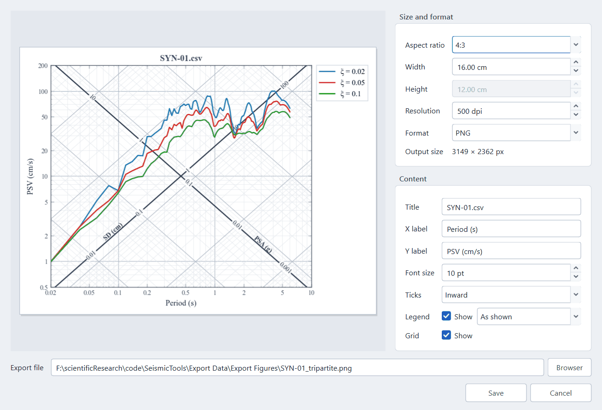

#### Size and format

| 设置项 | 说明 | 默认值 |
| --- | --- | --- |
| Export | 仅滞回环拆解图形显示：Combined figure（整体）/ Separate files（每圈单独一个文件） | Combined figure |
| Aspect ratio | 宽高比：4:3、3:2、16:9、1:1、5:4、2:1、Golden (1.618:1)、3:4 (portrait)、Free | 4:3 |
| Width / Height | 图形尺寸（cm）。固定比例时高度由宽度计算；选择 **Free** 后可直接输入高度，或拖动预览框右下角的手柄调整尺寸 | 16 cm × 12 cm |
| Resolution | 分辨率（dpi） | 500 dpi |
| Format | PNG、JPEG、TIFF（位图），SVG、PDF、EPS（矢量） | PNG |
| Output size | 位图的输出像素尺寸（只读） | — |

#### Content

| 设置项 | 说明 |
| --- | --- |
| Title | 图形标题（多子图图形为总标题；Separate files 模式下各圈保留各自标题） |
| X label / Y label | 坐标轴标签（多子图图形为公共标签） |
| Font size | 基础字号（pt），默认按图宽自动确定（8 cm → 8 pt，16 cm → 10 pt，范围 7～14 pt）。标题比基础字号大 1 pt，刻度值比基础字号小 1.5 pt（多子图小 2.5 pt），图例比基础字号小 0.5 pt |
| Ticks | 刻度方向：Inward（向内）、Outward（向外）、Both（双向） |
| Legend | 是否显示图例；位置可选 As shown（保持界面中的位置，如三联谱的图外图例）、Best、Upper left、Upper right、Lower left、Lower right |
| Grid | 是否显示网格（三联谱的自绘坐标网格同样受此控制） |

默认导出路径为 `{导出目录}/Export Figures/{图形名称}`。导出时程序自动检查图形内容是否超出画布，超出时自动扩展边界，保证标签完整。

### 13.2 表格导出（右键）

在任意数据表上单击右键 → **Export table data…**：

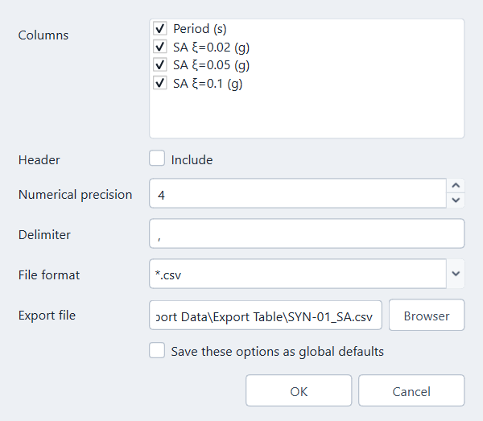

| 设置项 | 说明 |
| --- | --- |
| Columns | 勾选要导出的列 |
| Header | 是否包含表头 |
| Numerical precision | 小数位数 |
| Delimiter | 分隔符，输入 `\t` 表示制表符 |
| File format | `*.csv`、`*.txt`，或选择 `*.other` 后输入自定义后缀（如 `*.dat`） |
| Export file | 导出文件路径，默认 `{导出目录}/Export Table/{表格名称}` |
| Save these options as global defaults | 勾选后，本次的表头、精度、分隔符、文件格式写入全局设置 |

Header、Numerical precision、Delimiter、File format 的初始值读取自全局设置。导出数据为全精度数值按设定小数位格式化（不受界面显示位数影响），空值导出为空字符串；文件编码为 UTF-8（带 BOM），可直接用 Excel 打开且表头中的 Δ、ξ 等字符正常显示。

### 13.3 批量导出（Export all）

各页面的 **Export all** 按钮打开批量导出窗口：

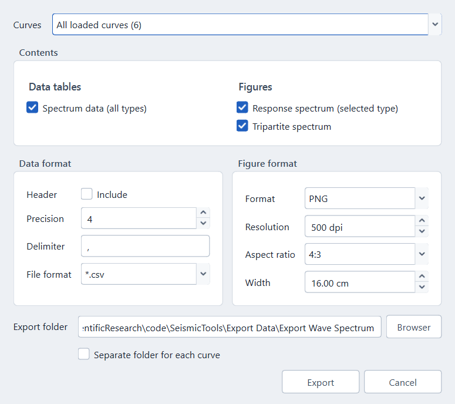

| 区域 | 说明 |
| --- | --- |
| Curves | All loaded curves（全部已加载曲线）或 Current curve only（仅当前曲线）。地震动参数页面导出的是汇总结果，不显示此项 |
| Contents | 按 Data tables / Figures 分组列出可导出的内容，勾选需要的项（各页面内容见对应章节） |
| Data format | Header、Precision、Delimiter、File format，初始值读取自全局设置 |
| Figure format | Format（默认 PNG）、Resolution（默认 500 dpi）、Aspect ratio（默认 4:3）、Width（默认 16 cm）；字号按图宽自动确定。滞回分析页面另有 Loop figures 选项 |
| Export folder | 导出目录，默认 `{导出目录}/Export {页面名称}` |
| Separate folder for each curve | 勾选后每条曲线的文件放入以曲线名命名的子文件夹 |

点击 **Export** 开始导出，导出过程显示进度条，完成后提示导出的文件数量与目录。

各页面的默认导出文件夹：

| 页面 | 默认文件夹 |
| --- | --- |
| Response Spectrum | Export Response Spectrum |
| Wave Response Spectrum | Export Wave Spectrum |
| Amplitude Seismic Wave | Export Amplitude Wave |
| Ground Motion Params | Export Ground Motion Parameters |
| Hysteresis Analysis | Export Hysteresis Results |
| Skeleton Curve | Export Skeleton Curve |

### 13.4 导出选中的波形/反应谱数据

规范反应谱列表、地震波调幅页面的右键 **Export selected …** 命令及 **Export selected** 按钮使用波形导出窗口：

| 设置项 | 说明 |
| --- | --- |
| Time column / Accel column | 时间（周期）列与加速度列在输出文件中的列号；取消勾选则不导出该列 |
| Header | 是否包含表头 |
| Separate folder | 每条波形单独建立子文件夹 |
| Numerical precision | 小数位数 |
| Delimiter | 分隔符 |
| File format | 文件后缀 |
| Export path | 导出目录 |

各项初始值读取自全局设置。

---

## 14. 全局设置（Settings）

点击侧边栏 **Settings** 打开设置窗口：

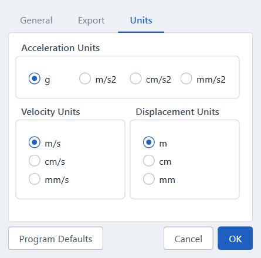

| 设置项 | 说明 |
| --- | --- |
| Import path | 导入对话框的初始目录 |
| Export path | 导出根目录（图形、表格、批量导出的默认位置均在其下） |
| Time column / Accel column | 波形导出窗口中时间列、加速度列的默认列号及是否导出 |
| Header | 导出时是否默认包含表头 |
| Separate folder | 导出时是否默认为每条曲线建立子文件夹 |
| Numerical precision | 默认小数位数 |
| Delimiter | 默认分隔符 |
| File format | 默认文件格式 |
| Language | 界面语言（English / 中文），与侧边栏的语言按钮相同 |
| Acceleration/Velocity/Displacement Units | 地震动参数页输出结果的加速度、速度、位移单位（见 [7.2 节](#72-参数选项)），在该页点击 Calculate 后生效；其他页面按各自的说明使用单位 |

- **OK**：保存设置到 `settings.ini`。
- **Program Defaults**：确认后恢复程序默认设置并立即保存（导入目录 `Import Data`、导出目录 `Export Data`，均位于程序的工作目录下；导出默认为不含表头、逗号分隔、4 位小数、`*.csv`）。
- **Cancel**：放弃修改。

表格导出窗口中勾选 “Save these options as global defaults” 也会更新这里的导出默认值。

程序的工作目录是启动时的当前目录。通过安装程序安装后，开始菜单与桌面快捷方式的起始位置是 `文档\SeismicTools`，`settings.ini`、`Import Data` 和 `Export Data` 都在这里；直接运行 exe 而当前目录不可写（例如在 `Program Files` 中）时，程序会自动改用这个目录。卸载程序不会删除其中的数据。

---

## 15. 常见问题与注意事项

**Q1：规范反应谱的中间参数显示 `--`，并提示 “Failed to find … value”。**
所选参数组合在规范参数表中没有对应值（如 D 类桥梁的 E2 地震作用），请手动输入中间参数后再计算。

**Q2：数据以制表符或空格对齐的地震波文件如何导入？**
在导入窗口的 Delimiter 中选择 Tab 或 Whitespace。Whitespace 把任意数量的连续空格或制表符视为一个分隔符，适合按固定宽度对齐的文本。选择 Custom 时须输入一个字符，留空会提示 “Please enter a custom delimiter!”。

**Q3：PEER 文件导入失败。**
程序在文件前 4 行查找形如 `NPTS=  5000, DT=   .0100 SEC` 的行。如果文件头被修改或格式不同，可将数据整理为每行一个数值，再按 Singal accel 类型导入：设置 First line 跳过文件头，并填写 Time step。

**Q4：地震波反应谱切换到另一条记录后图形为空。**
修改 Spectrum options 后，只有当前记录会自动重算；其他记录需要再次点击 **Calculate**。

**Q5：滞回分析提示 “No complete loading cycle was found in the data!”。**
数据中没有回到零位移的完整加载圈。请检查位移、力列是否正确，数据是否按加载顺序排列，以及 Zero tolerance 是否过大（过大的容差会把小幅值加载圈当作零点附近的波动）。

**Q6：骨架曲线缺少某些加载级，或同一级被提取了两次。**
调整 Level tolerance：同级重复加载的幅值波动较大时适当增大；相邻加载级幅值相差较小时适当减小。

**Q7：极限点一行带有 `*`。**
试验中荷载没有下降到 Ultimate load 设定的比例，程序以骨架曲线最后一点作为极限点，此时延性系数为下限估计。

**Q8：最远点法屈服点为空。**
骨架曲线接近直线（至峰值点前基本线弹性），最远点法无法确定明确的屈服点。

**Q9：导出的图片中文字或图例显示不完整。**
导出时程序会自动扩展画布以容纳全部内容。如仍不理想，可在导出窗口中增大 Width 或减小 Font size；三联谱的图例在图外右侧，建议使用 16:9 或 Free 比例。

**Q10：窗口宽度不够，右侧图形拥挤。**
点击侧边栏的折叠按钮（«），侧边栏收窄后可为结果区腾出约 150 像素宽度。

**Q11：修正后峰值荷载变化很大，或结果不合理。**
先检查几何参数的单位（长度按当前显示单位输入）、竖向力的符号（受压为正）以及所选的加载装置是否与试验一致。竖向力相对水平力很大而加载高度 $L$ 较小时，$P\Delta/L$ 修正量会很大。

**Q12：竖向力曲线与水平力曲线的位移精度不同，如何对齐？**
无需预处理。选择 Source 为 Force-displacement 并导入竖向力–位移曲线，程序按位移累计行程自动融合（见 [10.4 节](#104-竖向力与水平力曲线的融合)）；只有竖向力时程时选择 Time history，按数据点序号对齐。

**Q13：试验曲线处理检出了过多或过少的等待段。**
先在右下时程图中核对被标出的区域，再调整 Flatness tolerance 与 Minimum length（见 [11.2 节](#112-检测与剔除方法)），也可在列表中逐段取消勾选需要保留的段。

**Q14：桩基页面点击 Calculate 后提示计算失败，或没有结果。**
先检查 Pile Data 页的输入是否满足要求（如土层厚度和 $m$ 必须大于零、至少有一根桩），页面顶部的红色文字会给出原因。

**Q15：Pile Forces 的结果与算例的手算结果略有差异。**
手算使用取位后的中间值，两者通常相差 0.1 % 至 0.5 %。选择 Direct calculation 可以排除查表插值的影响。

**Q16：Bearing Capacity 页没有 $N_{\max}$ 校核一行。**
需要先在 Pile Forces 页点击 Calculate。修改 Pile Data 页的任何输入都会清除该结果。

---

## 16. 参考文献

1. GB 50111-2006 铁路工程抗震设计规范（2009 年版）[S].
2. JTG/T 2231-01-2020 公路桥梁抗震设计规范[S].
3. GB 50011-2010 建筑抗震设计规范（2016 年版）[S].
4. JGJ/T 101-2015 建筑抗震试验规程[S].
5. 冯鹏, 强翰霖, 叶列平. 材料、构件、结构的“屈服点”定义与讨论[J]. 工程力学, 2017, 34(3): 36-46.
6. Chopra A K. Dynamics of Structures: Theory and Applications to Earthquake Engineering[M]. Pearson.（第 5.2 节，分段线性激励的精确解）
7. Nigam N C, Jennings P C. Calculation of response spectra from strong-motion earthquake records[J]. Bulletin of the Seismological Society of America, 1969, 59(2).
8. Park R. Evaluation of ductility of structures and structural assemblages from laboratory testing[J]. Bulletin of the New Zealand National Society for Earthquake Engineering, 1989, 22(3).
9. Arias A. A measure of earthquake intensity[M]//Hansen R J. Seismic Design for Nuclear Power Plants. Cambridge: MIT Press, 1970: 438-483.
10. Housner G W. Spectrum intensities of strong-motion earthquakes[C]//Proceedings of the Symposium on Earthquake and Blast Effects on Structures. Los Angeles, 1952.
11. Trifunac M D, Brady A G. A study on the duration of strong earthquake ground motion[J]. Bulletin of the Seismological Society of America, 1975, 65(3).
12. Park Y J, Ang A H-S, Wen Y K. Seismic damage analysis of reinforced concrete buildings[J]. Journal of Structural Engineering, 1985, 111(4).
13. Nuttli O W. The relation of sustained maximum ground acceleration and velocity to earthquake intensity and magnitude[R]. Miscellaneous Paper S-71-1, Report 16. Vicksburg: U.S. Army Engineer Waterways Experiment Station, 1979.
14. Sarma S K, Yang K S. An evaluation of strong motion records and a new parameter A95[J]. Earthquake Engineering & Structural Dynamics, 1987, 15(1): 119-132.
15. Von Thun J L, Roehm L H, Scott G A, Wilson J A. Earthquake ground motions for design and analysis of dams[C]//Earthquake Engineering and Soil Dynamics II. ASCE Geotechnical Special Publication 20, 1988: 463-481.
16. Bradley B A. Empirical equations for the prediction of displacement spectrum intensity and its correlation with other intensity measures[J]. Soil Dynamics and Earthquake Engineering, 2011, 31(8).
17. Rathje E M, Abrahamson N A, Bray J D. Simplified frequency content estimates of earthquake ground motions[J]. Journal of Geotechnical and Geoenvironmental Engineering, 1998, 124(2): 150-159.
18. Applied Technology Council. ATC 3-06 Tentative provisions for the development of seismic regulations for buildings[R]. 1978.
19. 钢筋混凝土桥墩抗震性态数值评价与试验研究[D]. 大连: 大连理工大学. 第 3.1.3 节 P-Δ 效应.
20. Benjamin J R & Associates. A criterion for determining exceedance of the Operating Basis Earthquake[R]. EPRI Report NP-5930. Palo Alto, California: Electric Power Research Institute, 1988.（EDA）
21. Anderson J C, Bertero V V. Uncertainties in establishing design earthquakes[J]. Journal of Structural Engineering, 1987, 113(8): 1709-1724.（MIV）
22. Malhotra P K. Cyclic-demand spectrum[J]. Earthquake Engineering & Structural Dynamics, 2002, 31(7): 1441-1457.（DI、Ne）
23. ASTM. Cycle counting in fatigue analysis[S]. Annual Book of ASTM Standards, Vol. 03.01, Designation E1049-85, 1985.（雨流计数）
24. Panella D S, Tornello M E, Frau C. A simple and intuitive procedure to identify pulse-like ground motions[J]. Soil Dynamics and Earthquake Engineering, 2017, 94: 234-243.（IP）
25. Bianchini M, Diotallevi P, Baker J W. Prediction of inelastic structural response using an average of spectral accelerations[C]//10th International Conference on Structural Safety and Reliability (ICOSSAR09). Osaka, 2009.（Sa,avg）
26. Campbell K W, Bozorgnia Y. Prediction equations for the standardized version of cumulative absolute velocity as adapted for use in the shutdown of U.S. nuclear power plants[J]. Nuclear Engineering and Design, 2011, 241: 2558-2569.（CAV_STD）
27. Guaman J W. Empirical ground motion relationship for maximum incremental velocity[D]. University of Notre Dame, 2010.（MIV）
28. Hancock J, Bommer J J. The effective number of cycles of earthquake ground motion[J]. Earthquake Engineering & Structural Dynamics, 2005, 34: 637-664.（DI、Ne）
29. 王慧东, 朱英磊. 桥梁墩台与基础工程[M]. 2版. 北京: 中国铁道出版社, 2017: 第5章及附录A、B.（桩基础）
30. JTG 3362-2018 公路钢筋混凝土及预应力混凝土桥涵设计规范[S].（混凝土弹性模量）

---

## 附录 A　单位约定

| 物理量 | 程序内部 / 输出单位 | 说明 |
| --- | --- | --- |
| 地震波加速度 | g | 导入时按 Unit 换算，$g = 9.80665\ \mathrm{m/s^2}$ |
| 速度、位移（地震动参数、反应谱） | cm/s、cm | 由加速度积分得到 |
| SA、PSA | g | |
| SV、PSV | cm/s | |
| SD | cm | |
| 规范反应谱 | g | 周期单位 s |
| 滞回位移 | 内部 mm，显示 mm/cm/m/in | $1\ \mathrm{in} = 25.4\ \mathrm{mm}$ |
| 滞回力 | 内部 kN，显示 N/kN/kip | $1\ \mathrm{kip} = 4.4482\ \mathrm{kN}$ |
| 刚度 | 力单位/位移单位 | 如 kN/mm |
| 滞回环面积（耗能） | 力单位·位移单位 | 如 kN·mm |
| 桩基础：力、长度、应力 | kN、m、kPa | 承台位移内部为 m（表中以 mm 显示），转角为 rad |
| 桩基础：刚度 | kN/m、kN·m/rad | 六自由度弹簧与分布弹簧 |

## 附录 B　右键菜单一览

| 位置 | 菜单项 |
| --- | --- |
| 任意图形 | Save figure as image… |
| 任意数据表（Table 标签页、特征值表等） | Export table data… |
| 规范反应谱列表 | Delete selected response spectrum、Export selected response spectrum |
| 地震波调幅：Imported wave 列表 | Delete selected wave、Export selected wave |
| 地震波调幅：Target Accel 列表 | Delete selected wave、Export selected wave |
| 地震波反应谱 / 地震动参数：Imported waves 列表 | Delete selected waves |
| 滞回分析 / 骨架曲线：Imported data 列表 | Delete selected data |
| 滞回曲线修正：Characteristic values 表 | Export table data… |
| 试验曲线处理：Waiting segments 列表 | Export table data… |
